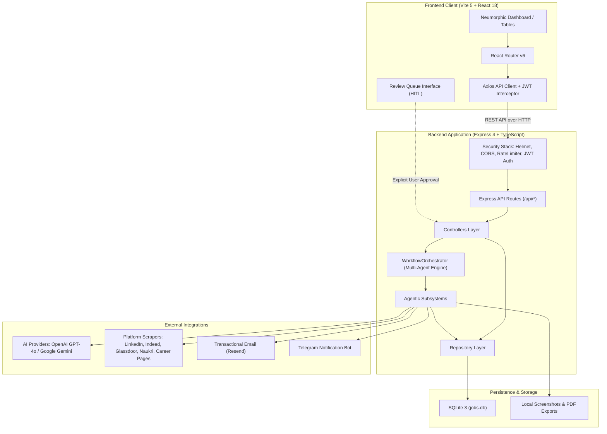
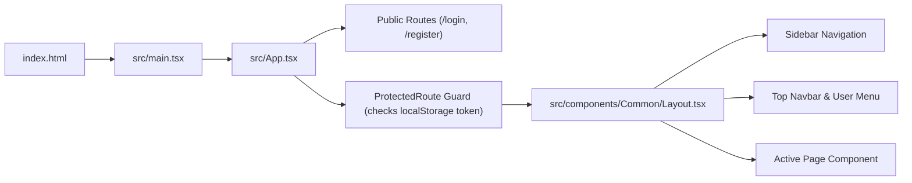
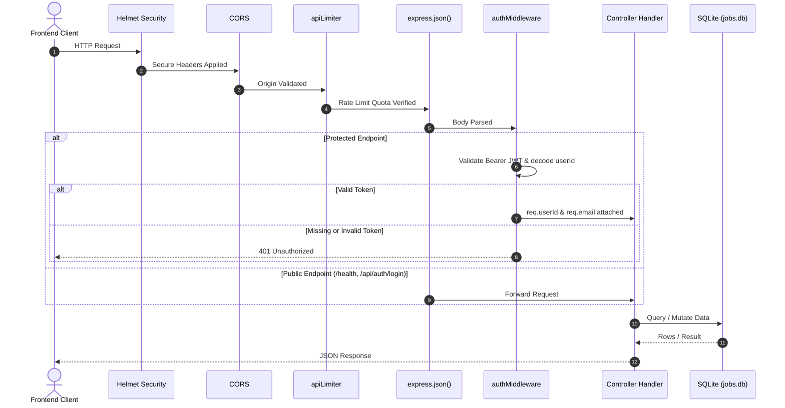
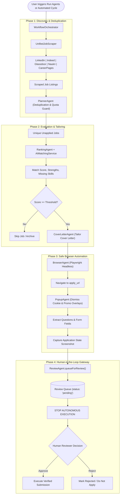

# AutoJobApply — System Architecture Specification

**Document Version:** 2.0 (Post Phase 3 Cleanup Baseline)  
**Date:** November 2026  
**Status:** Certified Stable

---

## 1. System Overview

**AutoJobApply** is an autonomous, agentic job search, matching, and application preparation platform. Designed with a strict **Human-in-the-Loop (HITL)** architecture, the system autonomously searches job boards, filters duplicates, ranks job descriptions against parsed candidate resumes, tailors cover letters, and prepares complete application drafts via headless browser automation—**without ever submitting an application or agreeing to legal declarations without explicit human confirmation.**

---

## 2. Frontend Architecture

### 2.1 Technology Stack
* **Runtime / Bundler:** Vite 5.4 + TypeScript 5.3
* **Framework:** React 18.2 (Functional Components + Hooks)
* **Routing:** `react-router-dom` v6.20
* **Data Fetching & Caching:** `@tanstack/react-query` v5.28 + `axios` v1.6
* **UI & Styling:** Custom Neumorphic CSS System + Tailwind CSS v3.4 + Framer Motion v12.4
* **Icons:** `lucide-react`
* **Client Document Generation:** `jspdf` + `html2canvas`

### 2.2 Entry Points & Routing Structure
* **HTML Host:** [`frontend/index.html`](file:///c:/Users/MEDICOVER/Desktop/auto-ai/autoJobApply/frontend/index.html)
* **Bootstrap Entry:** [`frontend/src/main.tsx`](file:///c:/Users/MEDICOVER/Desktop/auto-ai/autoJobApply/frontend/src/main.tsx)
* **Application Shell & Route Switcher:** [`frontend/src/App.tsx`](file:///c:/Users/MEDICOVER/Desktop/auto-ai/autoJobApply/frontend/src/App.tsx)

#### Route Inventory
| Route Path | Component | Protected | Purpose |
| :--- | :--- | :---: | :--- |
| `/login` | `Login.tsx` | No | User authentication |
| `/register` | `Register.tsx` | No | Account creation |
| `/dashboard` | `Dashboard.tsx` | Yes | Real-time statistics, active runs, application pulse |
| `/jobs` | `JobsTable.tsx` | Yes | Job discovery table, search, manual trigger |
| `/review-queue` | `ReviewQueue.tsx` | Yes | **HITL Gateway:** Application draft review & explicit approval |
| `/applications` | `ApplicationsList.tsx` | Yes | Historical applied/interview/rejected applications |
| `/companies` | `Companies.tsx` | Yes | Tracked companies, fit score distribution, AI discovery |
| `/resume` | `ResumeManager.tsx` | Yes | Active resume ATS scoring & PDF upload |
| `/resume-builder` | `ResumeBuilder.tsx` | Yes | Interactive JSON/form-based resume designer |
| `/resume-versions` | `ResumeVersions.tsx` | Yes | Multi-profile resume management for role tailoring |
| `/cover-letters` | `CoverLetters.tsx` | Yes | Generated letter repository, editing, and preview |
| `/analytics` | `Analytics.tsx` | Yes | Conversion funnel, platform response rates, heatmap |
| `/activity-logs` | `ActivityLogs.tsx` | Yes | Audit log entries with screenshots |
| `/settings` | `Settings.tsx` | Yes | Job search criteria, thresholds, platform toggles |

### 2.3 State Management & API Client
1. **Authentication State:** Managed via `useAuth.ts` hook. Inspects `localStorage.getItem('token')` and caches user profile data.
2. **API Client Singleton:** Centered in [`frontend/src/api/auth.ts`](file:///c:/Users/MEDICOVER/Desktop/auto-ai/autoJobApply/frontend/src/api/auth.ts). An Axios instance configured with `baseURL = import.meta.env.VITE_API_URL || '/api'`.
3. **JWT Injection:** An Axios request interceptor injects `Authorization: Bearer <token>` on every outgoing request automatically.

---

## 3. Backend Architecture

### 3.1 Technology Stack
* **Runtime:** Node.js v20+ (ES Modules format: `"type": "module"`)
* **Web Framework:** Express 4.18 + TypeScript 5.3
* **Database Driver:** `sqlite` v5.1 + `sqlite3` v6.0 (embedded WAL-mode SQLite database in `jobs.db`)
* **Browser Automation:** Playwright v1.40 (Chromium headless engine)
* **Security & Auth:** `jsonwebtoken` v9.0, `bcryptjs` v2.4, `helmet` v7.1, `express-rate-limit` v7.1
* **File Processing:** `multer` v1.4, `pdf-parse` v1.1

### 3.2 Request-Response Pipeline
Every request passing into the Express server traverses the following middleware stack:

### 3.3 Layered Architecture Components
1. **Entry Point ([`backend/src/app.ts`](file:///c:/Users/MEDICOVER/Desktop/auto-ai/autoJobApply/backend/src/app.ts)):** Bootstraps Express, registers global middlewares, wires all 13 modular routers under `/api/*`, attaches `/health` and `/api/health`, initializes database connection and triggers graceful shutdown handlers (`SIGTERM`).
2. **Configuration (`backend/src/config/`):**
   * `database.ts`: Singleton SQLite connection manager, table schema creation, embedded schema migrations, foreign keys enforcer.
   * `env.ts`: Central typed environment variables validator and path resolver.
   * `openai.ts`: LLM client initializer for OpenAI and fallback heuristics.
   * `playwrightConfig.ts`: Browser launch args, anti-detection flags, viewport defaults.
3. **Middleware (`backend/src/middleware/`):**
   * `auth.ts`: Token extractor, signature verifier, `req.userId` injector.
   * `errorHandler.ts`: Central error format, HTTP status mapping, unhandled exception safety.
   * `rateLimiter.ts`: Sliding-window brute force protection (`authLimiter`: 10 req/15m; `apiLimiter`: 100 req/15m).
4. **Repositories (`backend/src/repositories/`):**
   * Data access abstraction over SQLite queries: `userRepository`, `jobRepository`, `applicationRepository`, `matchScoreRepository`, `resumeVersionRepository`, `coverLetterRepository`, `activityLogRepository`.

---

## 4. Multi-Agent Automation System

The automation engine operates as a cooperative multi-agent system coordinated by the `WorkflowOrchestrator`:

### Agent Roles & Responsibilities

| Agent / Service | Core Responsibility | Safety Guard Enforced |
| :--- | :--- | :--- |
| **`WorkflowOrchestrator`** | Master lifecycle controller | Direct auto-apply bypass removed; unconditionally routes drafts to Review Queue. |
| **`UnifiedJobScraper`** | Platform scraper dispatcher | Injects `explicitUserConfirmation: false` during draft phases. |
| **`PlannerAgent`** | Plan generator & duplicate filter | Checks previous applications in database to eliminate re-applying to identical listings. |
| **`RankingAgent`** | Candidate-to-job ATS scoring | Evaluates requirements via OpenAI/Gemini; falls back gracefully to deterministic keyword matching. |
| **`CoverLetterAgent`** | Custom cover letter generation | Uses candidate resume profile and job description to craft bespoke application letters. |
| **`BrowserAgent`** | Browser navigation & screenshot capture | Navigates to application portal, inputs candidate details, captures PNG visual proof. |
| **`PopupAgent`** | Overlay mitigation | Safe dismissal of cookie banners; **prohibited** from selecting arbitrary questionnaire radio buttons/dropdowns. |
| **`ReviewAgent`** | Human-in-the-loop gatekeeper | Manages review records; requires authenticated user ownership and explicit confirmation token. |
| **`LoggerAgent`** | Audit trail recorder | Writes persistent activity entries with timestamps and screenshot file links. |

---

## 5. Security & Data Protection Architecture

1. **Credential Safety:** Secrets (`JWT_SECRET`, `OPENAI_API_KEY`, `RESEND_API_KEY`) are managed strictly via process environment variables; never hardcoded, never serialized in client responses.
2. **Password Storage:** Hashed using `bcryptjs` with salt work factor of 10.
3. **Database Security:** SQLite parameterized prepared statements (`?` placeholders) throughout all repositories, completely eliminating SQL injection vectors.
4. **Rate Limiting:** Prevents brute-force credential stuffing on `/api/auth/*` and endpoint exhaustion on API routes.
5. **Human Approval Mandate:** Applications cannot progress from `'pending'` to `'applied'` without an explicit HTTP POST to `/api/review-queue/:id/approve` carrying a verified session JWT matching the application owner.

