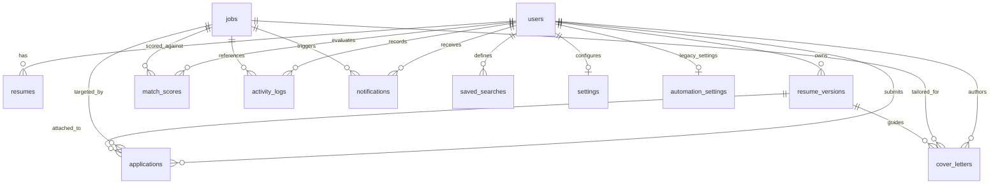

# AutoJobApply — SQLite Database Schema Specification

**Database File:** `backend/jobs.db`  
**Engine:** SQLite 3 (WAL Journal Mode)  
**ORM / Driver:** `sqlite` v5.1 + `sqlite3` v6.0  
**Integrity Mode:** `PRAGMA foreign_keys = ON;`  
**Version:** 2.0 (Post Phase 3 Cleanup Baseline)

---

## 1. Entity-Relationship Overview

---

## 2. Table Specifications

### 2.1 `users`
Core user identity, credentials, role, and search criteria defaults.
| Column | Type | Constraints | Description |
| :--- | :--- | :--- | :--- |
| `id` | `TEXT` | `PRIMARY KEY DEFAULT (lower(hex(randomblob(16))))` | UUID v4 equivalent hex string |
| `email` | `VARCHAR(255)` | `UNIQUE NOT NULL` | Candidate email address |
| `password_hash` | `VARCHAR(255)` | `NOT NULL` | bcrypt hash |
| `full_name` | `VARCHAR(255)` | | Candidate full name |
| `role` | `VARCHAR(50)` | `DEFAULT 'user'` | Access control role |
| `preferred_locations`| `TEXT` | `DEFAULT '[]'` | JSON array of target locations |
| `employment_type` | `VARCHAR(50)` | `DEFAULT 'Full-Time'` | Desired work type |
| `min_match_score` | `INTEGER` | `DEFAULT 80` | Default AI ranking cutoff score |
| `is_verified` | `INTEGER` | `DEFAULT 0` | Email verification flag (0 or 1) |
| `verification_token`| `VARCHAR(255)`| | Account activation token |
| `reset_token` | `VARCHAR(255)`| | Password reset token |
| `reset_token_expires`|`DATETIME` | | Password reset expiration |
| `created_at` | `DATETIME` | `DEFAULT CURRENT_TIMESTAMP` | Account creation timestamp |
| `updated_at` | `DATETIME` | `DEFAULT CURRENT_TIMESTAMP` | Last profile update |

**Indexes:**
* `idx_users_email` ON `users(email)`
* `sqlite_autoindex_users_1` (PK on `id`)
* `sqlite_autoindex_users_2` (UNIQUE on `email`)

---

### 2.2 `jobs`
Scraped job opportunities across all integrated platforms.
| Column | Type | Constraints | Description |
| :--- | :--- | :--- | :--- |
| `id` | `TEXT` | `PRIMARY KEY DEFAULT (lower(hex(randomblob(16))))` | Unique job identifier |
| `title` | `VARCHAR(255)` | `NOT NULL` | Job posting title |
| `company_name` | `VARCHAR(255)` | `NOT NULL` | Hiring company |
| `location` | `VARCHAR(255)` | | City, state, or 'Remote' |
| `salary` | `VARCHAR(100)` | | Pay rate or compensation range |
| `experience_level` | `VARCHAR(50)` | | Seniority level (Entry, Mid, Senior) |
| `required_skills` | `TEXT` | `DEFAULT '[]'` | JSON array of parsed technical skills |
| `job_description` | `TEXT` | | Full text job description |
| `apply_url` | `VARCHAR(500)` | | Target URL for browser automation |
| `source` | `VARCHAR(100)` | | 'LinkedIn', 'Indeed', 'Glassdoor', 'Naukri', 'CareerPages' |
| `posted_date` | `DATETIME` | | Date job was posted |
| `external_id` | `VARCHAR(500)` | | Platform-specific job ID |
| `status` | `VARCHAR(50)` | `DEFAULT 'new'` | 'new', 'processed', 'archived' |
| `created_at` | `DATETIME` | `DEFAULT CURRENT_TIMESTAMP` | Discovered timestamp |
| `updated_at` | `DATETIME` | `DEFAULT CURRENT_TIMESTAMP` | Last updated |

**Indexes:**
* `idx_jobs_source` ON `jobs(source)`
* `sqlite_autoindex_jobs_1` (PK on `id`)

---

### 2.3 `applications`
Application tracking records, review queue state, and submission metadata.
| Column | Type | Constraints | Description |
| :--- | :--- | :--- | :--- |
| `id` | `TEXT` | `PRIMARY KEY DEFAULT (lower(hex(randomblob(16))))` | Application ID |
| `user_id` | `TEXT` | `NOT NULL REFERENCES users(id)` | Owning user |
| `job_id` | `TEXT` | `NOT NULL REFERENCES jobs(id)` | Target job |
| `status` | `VARCHAR(50)` | `DEFAULT 'pending'` | 'pending', 'applied', 'interview', 'rejected', 'offer' |
| `review_status` | `VARCHAR(50)` | `DEFAULT 'pending'` | 'pending', 'approved', 'rejected' (**HITL guard**) |
| `applied_at` | `DATETIME` | `DEFAULT CURRENT_TIMESTAMP` | Timestamp created/submitted |
| `interview_scheduled`|`INTEGER` | `DEFAULT 0` | Flag (0 or 1) |
| `interview_date` | `DATETIME` | | Scheduled interview datetime |
| `rejected` | `INTEGER` | `DEFAULT 0` | Flag (0 or 1) |
| `offer_received` | `INTEGER` | `DEFAULT 0` | Flag (0 or 1) |
| `notes` | `TEXT` | | User notes or recruiter correspondence |
| `resume_version_id`| `TEXT` | | Associated resume version used |
| `cover_letter_id` | `TEXT` | | Associated tailored cover letter ID |
| `match_score` | `REAL` | | Match score at time of draft prep |
| `screenshot_path` | `VARCHAR(500)` | | Path to application state proof screenshot |
| `warnings` | `TEXT` | `DEFAULT '[]'` | JSON array of detected form warnings |
| `scraped_questions`| `TEXT` | `DEFAULT '[]'` | JSON array of unanswered questions extracted from form |
| `updated_at` | `DATETIME` | `DEFAULT CURRENT_TIMESTAMP` | Last modification |

**Indexes:**
* `idx_applications_user_id` ON `applications(user_id)`
* `idx_applications_review_status` ON `applications(review_status)`
* `sqlite_autoindex_applications_1` (PK on `id`)
* `sqlite_autoindex_applications_2` (UNIQUE on `(user_id, job_id)`)

---

### 2.4 `match_scores`
AI ATS ranking evaluation scores between candidate resumes and job postings.
| Column | Type | Constraints | Description |
| :--- | :--- | :--- | :--- |
| `id` | `TEXT` | `PRIMARY KEY DEFAULT (lower(hex(randomblob(16))))` | Match evaluation ID |
| `user_id` | `TEXT` | `NOT NULL REFERENCES users(id)` | Candidate |
| `job_id` | `TEXT` | `NOT NULL REFERENCES jobs(id)` | Target job |
| `match_score` | `REAL` | | Calculated ATS percentage (0 - 100) |
| `missing_skills` | `TEXT` | `DEFAULT '[]'` | JSON array of skills required but missing |
| `matching_skills` | `TEXT` | `DEFAULT '[]'` | JSON array of matched candidate skills |
| `strengths` | `TEXT` | `DEFAULT '[]'` | JSON array of candidate advantages |
| `recommendation` | `VARCHAR(50)` | | 'strong_match', 'moderate_match', 'weak_match' |
| `analyzed_at` | `DATETIME` | `DEFAULT CURRENT_TIMESTAMP` | Timestamp evaluated |

**Indexes:**
* `idx_match_scores_user_id` ON `match_scores(user_id)`
* `sqlite_autoindex_match_scores_1` (PK on `id`)
* `sqlite_autoindex_match_scores_2` (UNIQUE on `(user_id, job_id)`)

---

### 2.5 `resumes`
Candidate's primary resume document and ATS parsed contents.
| Column | Type | Constraints | Description |
| :--- | :--- | :--- | :--- |
| `id` | `TEXT` | `PRIMARY KEY DEFAULT (lower(hex(randomblob(16))))` | Resume ID |
| `user_id` | `TEXT` | `NOT NULL REFERENCES users(id)` | Owner user |
| `file_name` | `VARCHAR(255)` | | Original uploaded filename |
| `file_path` | `VARCHAR(255)` | | Filesystem path |
| `text_content` | `TEXT` | | Extracted text from PDF parser |
| `skills` | `TEXT` | `DEFAULT '[]'` | Extracted skills array |
| `experience` | `TEXT` | | Parsed work history |
| `education` | `TEXT` | | Parsed education details |
| `keywords` | `TEXT` | `DEFAULT '[]'` | Domain keywords |
| `builder_data` | `TEXT` | | JSON string of interactive builder state |
| `uploaded_at` | `DATETIME` | `DEFAULT CURRENT_TIMESTAMP` | Initial upload |
| `updated_at` | `DATETIME` | `DEFAULT CURRENT_TIMESTAMP` | Last update |

**Indexes:**
* `idx_resumes_user_id` ON `resumes(user_id)`
* `sqlite_autoindex_resumes_1` (PK on `id`)
* `sqlite_autoindex_resumes_2` (UNIQUE on `user_id`)

---

### 2.6 `resume_versions`
Multiple tailored resume variants (e.g. "Frontend Lead", "Fullstack", "DevOps").
| Column | Type | Constraints | Description |
| :--- | :--- | :--- | :--- |
| `id` | `TEXT` | `PRIMARY KEY DEFAULT (lower(hex(randomblob(16))))` | Version ID |
| `user_id` | `TEXT` | `NOT NULL REFERENCES users(id)` | Owner user |
| `label` | `VARCHAR(255)` | `NOT NULL` | Version name / specialty |
| `file_name` | `VARCHAR(255)` | | Original filename |
| `text_content` | `TEXT` | | Variant resume text |
| `skills` | `TEXT` | `DEFAULT '[]'` | Variant skills array |
| `is_default` | `INTEGER` | `DEFAULT 0` | Flag (1 if active default) |
| `created_at` | `DATETIME` | `DEFAULT CURRENT_TIMESTAMP` | Creation time |
| `updated_at` | `DATETIME` | `DEFAULT CURRENT_TIMESTAMP` | Last updated |

**Indexes:**
* `idx_resume_versions_user_id` ON `resume_versions(user_id)`

---

### 2.7 `cover_letters`
AI-generated and user-customized cover letters tailored to specific jobs.
| Column | Type | Constraints | Description |
| :--- | :--- | :--- | :--- |
| `id` | `TEXT` | `PRIMARY KEY DEFAULT (lower(hex(randomblob(16))))` | Cover letter ID |
| `user_id` | `TEXT` | `NOT NULL REFERENCES users(id)` | Author |
| `job_id` | `TEXT` | `REFERENCES jobs(id)` | Target job (nullable) |
| `resume_version_id`| `TEXT` | `REFERENCES resume_versions(id)` | Source resume variant |
| `content` | `TEXT` | `NOT NULL` | Full letter text |
| `generated_at` | `DATETIME` | `DEFAULT CURRENT_TIMESTAMP` | Generation timestamp |

**Indexes:**
* `idx_cover_letters_user_id` ON `cover_letters(user_id)`
* `idx_cover_letters_job_id` ON `cover_letters(job_id)`

---

### 2.8 `activity_logs`
Full audit trail of all agent actions, scrape cycles, and user approvals.
| Column | Type | Constraints | Description |
| :--- | :--- | :--- | :--- |
| `id` | `TEXT` | `PRIMARY KEY DEFAULT (lower(hex(randomblob(16))))` | Log ID |
| `user_id` | `TEXT` | `NOT NULL REFERENCES users(id)` | Target user |
| `job_id` | `TEXT` | `REFERENCES jobs(id)` | Associated job (nullable) |
| `action` | `VARCHAR(100)` | `NOT NULL` | Action code (e.g. `agent_run`, `draft_queued`, `approved`) |
| `details` | `TEXT` | | JSON string with step diagnostics |
| `screenshot_path` | `VARCHAR(500)` | | Relative path to visual proof |
| `status` | `VARCHAR(50)` | `DEFAULT 'success'` | 'success', 'warning', 'failed' |
| `created_at` | `DATETIME` | `DEFAULT CURRENT_TIMESTAMP` | Event timestamp |

**Indexes:**
* `idx_activity_logs_user_id` ON `activity_logs(user_id)`
* `idx_activity_logs_action` ON `activity_logs(action)`
* `idx_activity_logs_created_at` ON `activity_logs(created_at)`

---

### 2.9 `settings` & `automation_settings`
User search criteria and automation thresholds.
* **`settings` (Active):** `user_id`, `target_roles` (JSON), `target_locations` (JSON), `min_salary`, `max_experience`, `preferred_platforms` (JSON), `auto_rank_threshold`.
* **`automation_settings` (Legacy):** `user_id`, `auto_apply_enabled`, `auto_apply_threshold`, `approval_mode_enabled`, `telegram_enabled`, `email_notifications`, `platforms_enabled`.

---

### 2.10 `notifications` & `saved_searches`
* **`notifications`:** User alerts (`notification_type`, `title`, `message`, `related_job_id`, `read`).
* **`saved_searches`:** User query presets (`keyword`, `location`, `experience`, `salary`, `remote`).

---

## 3. Schema Migrations Strategy

Database migrations are managed code-first in [`backend/src/config/database.ts`](file:///c:/Users/MEDICOVER/Desktop/auto-ai/autoJobApply/backend/src/config/database.ts) during startup inside `initializeDatabase()`:
1. `CREATE TABLE IF NOT EXISTS` executes for all 12 core tables.
2. `CREATE INDEX IF NOT EXISTS` executes for all 14 custom indexes.
3. Embedded migration array adds backward-compatible columns to legacy tables using `ALTER TABLE ... ADD COLUMN` wrapped in try/catch blocks to gracefully handle existing SQLite columns without throwing runtime errors.

