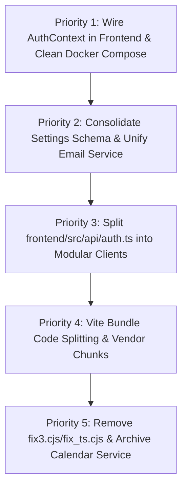

# AutoJobApply — Technical Debt & Architectural Audit

**Document Version:** 2.0 (Post Phase 3 Cleanup Baseline)  
**Date:** November 2026  
**Status:** Actionable Findings & Prioritized Roadmap

---

## 1. Executive Summary

Following the completion of Phase 1 (Human-in-the-Loop Safety Remediation), Phase 2 (Documentation & Scratch Cleanup), and Phase 3 (Prototype & Mobile Decommissioning), the core application builds cleanly, passes all safety tests, and runs with zero external Next.js conflicts.

However, an in-depth architecture audit has identified several legacy artifacts, dead services, and architectural inconsistencies accumulated during earlier development iterations. This document catalogs each item, its operational risk, and a prioritized remediation roadmap.

---

## 2. Technical Debt Catalog

### Priority 1: High Priority (Functional & Architectural Drift)

#### 1. Unscheduled Background Jobs in Server Lifecycle
* **Location:** [`backend/src/app.ts`](file:///c:/Users/MEDICOVER/Desktop/auto-ai/autoJobApply/backend/src/app.ts#L22-L24)
* **Finding:** `startJobDiscoveryJob`, `startAIMatchingJob`, and `startDailySummaryJob` are imported at the top of `backend/src/app.ts`, but are **never invoked** inside `startServer()`.
* **Impact:** Scheduled cron cycles for automated scraping and daily matching do not run automatically in the background unless triggered manually via the UI button (`POST /api/agents/run`).
* **Recommendation:** Wire these functions into `startServer()` guarded by an environment flag (e.g. `ENABLE_BACKGROUND_CRON=true`) to enable controlled autonomous scheduling without unexpected background runs during development.

#### 2. Auth State Fragmentation in Frontend
* **Location:** [`frontend/src/hooks/useAuth.ts`](file:///c:/Users/MEDICOVER/Desktop/auto-ai/autoJobApply/frontend/src/hooks/useAuth.ts)
* **Finding:** `useAuth` creates local React state (`useState`) within every component instance that invokes it, rather than consuming a centralized React Context.
* **Impact:** Every component mounting `useAuth` independently queries `GET /api/auth/profile`, creating redundant network traffic and potential state desynchronization between navigation bar and page bodies.
* **Recommendation:** Introduce an `AuthProvider` (`AuthContext.tsx`) wrapping `<App />` so that user profile, authentication state, and token management are shared globally across the component tree.

#### 3. Legacy PostgreSQL Configuration vs Active SQLite Reality
* **Location:** [`backend/src/config/env.ts`](file:///c:/Users/MEDICOVER/Desktop/auto-ai/autoJobApply/backend/src/config/env.ts#L7-L12) & [`docker-compose.yml`](file:///c:/Users/MEDICOVER/Desktop/auto-ai/autoJobApply/docker-compose.yml#L4-L14)
* **Finding:** `env.ts` maintains environment properties for `DB_HOST`, `DB_PORT`, `DB_NAME`, `DB_USER`, `DB_PASSWORD`, and `docker-compose.yml` spins up a `postgres:15-alpine` container. However, [`backend/src/config/database.ts`](file:///c:/Users/MEDICOVER/Desktop/auto-ai/autoJobApply/backend/src/config/database.ts) connects exclusively to SQLite (`backend/jobs.db`).
* **Impact:** Developer confusion, unnecessary Docker memory overhead running an unused PostgreSQL container, and misleading configuration documentation.
* **Recommendation:** Streamline `docker-compose.yml` to remove the redundant PostgreSQL container (or introduce a clear database driver abstraction if Postgres support is intended for future enterprise deployments).

---

### Priority 2: Medium Priority (Maintainability & Cleanliness)

#### 4. Duplicate Settings Tables in SQLite
* **Location:** [`backend/src/config/database.ts`](file:///c:/Users/MEDICOVER/Desktop/auto-ai/autoJobApply/backend/src/config/database.ts#L86-L125)
* **Finding:** The database contains two distinct settings tables: `automation_settings` (old schema containing `auto_apply_enabled`, `telegram_enabled`) and `settings` (current schema containing `target_roles`, `target_locations`, `auto_rank_threshold`).
* **Impact:** Two separate controllers/repositories manipulate user preferences without a unified data contract.
* **Recommendation:** Consolidate user preferences into a single canonical `settings` table with a clean database migration.

#### 5. Duplicate Email Implementations
* **Location:** [`backend/src/services/emailService.ts`](file:///c:/Users/MEDICOVER/Desktop/auto-ai/autoJobApply/backend/src/services/emailService.ts) vs [`backend/src/utils/email.ts`](file:///c:/Users/MEDICOVER/Desktop/auto-ai/autoJobApply/backend/src/utils/email.ts)
* **Finding:** `emailService.ts` wraps Resend for application confirmation emails (never invoked anywhere). Meanwhile, `utils/email.ts` wraps Resend with mock logging fallback for verification and password reset emails.
* **Impact:** Duplicate code and inconsistent fallback behavior when `RESEND_API_KEY` is omitted.
* **Recommendation:** Merge both into a single unified `EmailService` that handles all transactional messages (auth + application updates) with consistent development mock mode.

#### 6. Unintegrated Google Calendar Service
* **Location:** [`backend/src/services/calendarService.ts`](file:///c:/Users/MEDICOVER/Desktop/auto-ai/autoJobApply/backend/src/services/calendarService.ts)
* **Finding:** `CalendarService` implements Google OAuth2 token handling and interview calendar event creation, but has **zero callers** across the backend.
* **Impact:** Dead code increasing maintenance overhead.
* **Recommendation:** Either wire it to an interview scheduling flow in the Applications controller or archive it until that roadmap feature is scheduled.

#### 7. One-off Historical Patch Scripts in Repository Root
* **Location:** `backend/fix3.cjs` and `backend/fix_ts.cjs`
* **Finding:** These two standalone CommonJS scripts were used in previous development sessions to perform regex search-and-replace patches across scrapers and repositories.
* **Impact:** Clutter in the backend root directory; risks accidental re-execution that could mutate TypeScript source code.
* **Recommendation:** Move to `docs/archive/` or delete once confirmed they are no longer needed.

#### 8. Monolithic Frontend API Client File
* **Location:** [`frontend/src/api/auth.ts`](file:///c:/Users/MEDICOVER/Desktop/auto-ai/autoJobApply/frontend/src/api/auth.ts)
* **Finding:** A single 100-line file named `auth.ts` exports 12 distinct API clients: `authAPI`, `jobsAPI`, `applicationsAPI`, `dashboardAPI`, `reviewQueueAPI`, `resumeVersionsAPI`, `coverLettersAPI`, `activityLogsAPI`, `settingsAPI`, `exportsAPI`, `resumeAPI`, `analyticsAPI`.
* **Impact:** Poor discoverability and deceptive filename (`auth.ts` holds the entire application API layer).
* **Recommendation:** Split into domain-specific files (`api/client.ts`, `api/jobs.ts`, `api/applications.ts`, `api/reviewQueue.ts`, etc.) while re-exporting from an `api/index.ts`.

---

### Priority 3: Low Priority (Optimization & Polish)

#### 9. Frontend Bundle Splitting (Vite Output > 950KB)
* **Location:** [`frontend/vite.config.ts`](file:///c:/Users/MEDICOVER/Desktop/auto-ai/autoJobApply/frontend/vite.config.ts)
* **Finding:** Vite emits a chunk warning: `dist/assets/index-*.js: 950.83 kB │ gzip: 281.87 kB`.
* **Impact:** Slightly longer initial page load for cold cache users.
* **Recommendation:** Configure `rollupOptions.output.manualChunks` in `vite.config.ts` to separate vendor dependencies (`react`, `react-dom`, `framer-motion`, `lucide-react`, `jspdf`) into dedicated vendor chunks.

#### 10. Weak JWT Development Secret Fallback
* **Location:** [`backend/src/config/env.ts`](file:///c:/Users/MEDICOVER/Desktop/auto-ai/autoJobApply/backend/src/config/env.ts#L13)
* **Finding:** `JWT_SECRET: process.env.JWT_SECRET || 'your-secret-key'`.
* **Impact:** In development/testing environments without a configured `.env`, predictable tokens can be crafted if deployed without changing this value.
* **Recommendation:** In `env.ts`, emit a prominent warning when `NODE_ENV === 'production'` and the default fallback secret is detected.

---

## 3. Prioritized Implementation Roadmap

| Order | Action | Scope | Estimated Effort | Safety Risk |
| :---: | :--- | :--- | :---: | :---: |
| **1** | Create global `AuthContext` in frontend to eliminate redundant `/auth/profile` calls | `frontend/src/` | 1 hour | Minimal |
| **2** | Align `docker-compose.yml` with SQLite reality (remove unused Postgres service) | Root configs | 30 mins | Zero |
| **3** | Unify `emailService.ts` and `utils/email.ts` into a single resilient service | `backend/src/` | 1 hour | Zero |
| **4** | Clean up `backend/fix3.cjs` and `backend/fix_ts.cjs` into archive | `backend/` | 15 mins | Zero |
| **5** | Split `frontend/src/api/auth.ts` into modular domain API files | `frontend/src/api/` | 1.5 hours | Minimal |
| **6** | Configure `manualChunks` in `frontend/vite.config.ts` for bundle optimization | `frontend/` | 30 mins | Zero |

