# AutoApply AI — Complete User & Architecture Guide

Welcome to **AutoApply AI**, an open-source, multi-user autonomous job application and verification platform. This guide explains **how to give your resume**, **how the cronjob works (active vs. inactive)**, **how to check if applications are genuinely applied**, and **how the system operates behind the scenes**.

---

## 1. Quick Overview: What Is AutoApply AI?

AutoApply AI is not just another job scraper or spreadsheet tracker. It is a full-stack multi-agent system designed to:
1. **Discover verified active jobs** across 10+ portals (prioritizing direct company ATS boards like Greenhouse, Lever, and Ashby).
2. **Score matches with Gemini AI** against your real verified resume.
3. **Tailor your resume & cover letter** for each specific role without hallucinating credentials.
4. **Submit automatically** to open public ATS forms and direct recruiter emails via Playwright.
5. **Protect your security** by stopping on login walls and CAPTCHAs, pre-filling a 1-click application package instead.
6. **Track company confirmation emails & replies** (interview invites, confirmations, rejections) in your Gmail/IMAP inbox.
7. **Send hourly verification reports** with live screenshot proof to your **Email and WhatsApp**.

---

## 2. How to Give Your Resume (`/resume`)

### Supported Formats
* **PDF (`.pdf`) — Strongly Recommended:** Uploading a PDF preserves your formatting, allows Playwright to attach the actual `.pdf` file to company ATS boards, and enables precise ATS parsing.
* **DOCX (`.docx`) & Plain Text (`.txt`):** Also accepted; text and contacts are automatically extracted.

### Step-by-Step Upload Instructions
1. Open the web app and click the **Resume** tab in the sidebar (or navigate to `/resume`).
2. Drag and drop your resume file into the upload dropzone, or click **"Browse File"** to select it from your computer.
3. Once uploaded, the **Candidate Extractor Engine** automatically processes your file in seconds:
   - **Contact Extraction:** Pulls your Full Name, Email, and **WhatsApp Mobile Phone** (e.g., `+91 73472 34445`).
   - **Technical Skills Categorization:** Sorts your skills into *Languages*, *Frameworks & Libraries*, *Cloud & DevOps*, *Databases*, and *Developer Tools*.
   - **Baseline ATS Score:** Evaluates your resume across 5 dimensions and gives you an instant 0–100% score with grounded improvement suggestions.
   - **Single-Column ATS Master:** Converts your background into a clean, single-column, ATS-standard layout.

### Managing & Downloading Resume Versions
* **Original Master Resume:** Your uploaded resume is saved permanently as Version 1 (Baseline) and is **never overwritten**.
* **Job-Tailored Child Versions:** When the agent applies to a company (e.g. Stripe, GitLab, Reddit), it creates a dedicated child version (`Tailored for Stripe - Full Stack Engineer`).
* **Download PDF Anytime:** On the `/resume` page, select any tailored version and click **"Export PDF"** to download the exact ATS-optimized `.pdf` file.

---

## 3. Cron Job: Active vs. Inactive & Custom 1–5 Hour Gaps (`/settings`)

The system features an autonomous background cron scheduler that runs on Railway to search, score, tailor, and apply to jobs automatically.

### How to Make the Cron Job ACTIVE (Running)
1. Go to the **Settings** tab (`/settings`).
2. Scroll to the **Automated Application Submission** section.
3. Find the toggle: **"Scheduled Auto-Apply Cron (Default ON)"**.
4. Make sure the toggle switch is **ON** (purple highlight).
5. Choose your **Apply Frequency Gap**:
   - `Every 1 hr` (`0 * * * *`) — Runs every hour.
   - `Every 2 hrs` (`0 */2 * * *`) — Runs every 2 hours.
   - `Every 3 hrs` (`0 */3 * * *`) — Runs every 3 hours.
   - `Every 4 hrs` (`0 */4 * * *`) — Runs every 4 hours.
   - `Every 5 hrs` (`0 */5 * * *`) — Runs every 5 hours.
6. Click **"Save Settings"** at the bottom.

### How to Make the Cron Job INACTIVE (Paused / Stopped)
1. Go to **Settings** (`/settings`).
2. Click the **"Scheduled Auto-Apply Cron"** toggle switch to **OFF**.
3. Click **"Save Settings"** at the bottom.
4. **Result:** The background master timer will immediately skip your account on every run (`usersSkipped++`). It will not search, score, tailor, or apply to any jobs until you turn it back on.

### When Does It Run & How to Check the Next Run Time?
* **Master Timer Schedule:** The master cron ticks at minute `00` of every hour UTC (which is **:30 minutes of every hour in IST** — e.g., 09:30 AM, 10:30 AM, 11:30 AM, 12:30 PM, etc.).
* **Live Schedule Display in Settings:**
  - **Last Cron Run:** Shows the exact date and timestamp when the agent last processed jobs for you.
  - **Next Due:** Shows the exact upcoming date and time when the agent will run again based on your chosen 1–5 hr gap.

---

## 4. How to Check If Jobs Are Applied & Verified (`/applications`)

AutoApply AI never fakes submissions. You can verify every single job application using three distinct verification checks:

```
┌────────────────────────────────────────────────────────────────────────┐
│                        HOW TO CHECK YOUR APPLICATIONS                  │
├────────────────────────────────────────────────────────────────────────┤
│ 1. IN THE WEB APP (/applications)                                      │
│    • Green Badge: "Verified Applied" (Direct ATS / Recruiter Email)     │
│    • Blue Badge:  "AI Prepared · 1-Click Apply" (Login / CAPTCHA site) │
│    • Click any card to open the LIVE PROOF MODAL:                      │
│      - View the real Playwright screenshot of the confirmation page    │
│      - View the exact confirmation message received                    │
│      - View the tailored resume & Gemini cover letter used             │
│                                                                        │
│ 2. IN YOUR GMAIL INBOX (akhileshmekarthi28@gmail.com)                  │
│    • Official company receipt: "Thank you for applying to [Company]"   │
│    • Click "Check Company Replies" on /applications to scan for new    │
│      interview invites, confirmations, or status updates via IMAP.     │
│                                                                        │
│ 3. ON YOUR WHATSAPP (+91 73472 34445)                                  │
│    • Hourly push reports sent directly to your phone                   │
│    • Lists all newly verified applications with 1-click proof links    │
└────────────────────────────────────────────────────────────────────────┘
```

### Check 1: In the Web Dashboard (`/applications`)
1. Click **Applications** in the sidebar.
2. Review the status badges:
   - **`Verified Applied` (Green Badge):** Genuinely submitted directly to the employer's ATS by Playwright headless Chrome.
   - **`AI Prepared · 1-Click Apply` (Blue Badge):** The site has a login wall (LinkedIn, Workday) or CAPTCHA. The agent has generated your tailored resume and Gemini cover letter, and provided a **"Open Company Site"** button so you can submit cleanly in 10 seconds.
3. **Open Proof Modal:** Click on any application row. A modal will pop up displaying:
   - **Live Proof Screenshot:** The captured browser screen showing the submission confirmation or company portal.
   - **Confirmation Text:** e.g., *"Application submitted. Thank you for your interest in [Company]."*
   - **Timestamp & Platform:** Exact time and ATS name (Greenhouse, Lever, Ashby, etc.).

### Check 2: In Your Personal Gmail Inbox
- For every **`Verified Applied`** job, the external company's ATS sends an automated confirmation email directly to your email address (`akhileshmekarthi28@gmail.com`).
- **Inbox Reply Tracker:** On the `/applications` page, click the **"Check Company Replies"** button anytime. The system performs a read-only IMAP scan of your inbox to detect company confirmations, interview invitations, or rejections, updating your dashboard automatically.

### Check 3: On Your WhatsApp (`+91 73472 34445`)
- When enabled in **Settings**, AutoApply AI pushes an hourly summary report directly to your WhatsApp number.
- Each report lists the jobs processed, companies applied to, match scores, and direct links to inspect the proof.

---

## 5. How the Multi-Agent Pipeline Works Behind the Scenes

```mermaid
graph LR
    subgraph Discovery ["1. Discovery Agent"]
        D1["Greenhouse Boards"]
        D2["Ashby Boards"]
        D3["Lever Boards"]
        D4["Remote Portals"]
    end

    subgraph Intelligence ["2. AI Intelligence"]
        R1["Gemini Match Scorer"]
        R2["ATS Tailoring Engine"]
        R3["Gemini Cover Letter Drafter"]
    end

    subgraph Execution ["3. Execution & Verification"]
        E1["Playwright Form Submitter"]
        E2["Screenshot Capturer"]
        E3["IMAP Reply Scanner"]
    end

    Discovery --> Intelligence
    Intelligence --> Execution
```



1. **Discovery Agent:** Scrapes fresh postings directly from 16+ Greenhouse boards, 7+ Ashby boards, Lever boards, and Remote portals. Skips closed jobs and postings older than 14–21 days.
2. **AI Ranking Agent (Gemini):** Scores jobs against your resume. If a job scores below your threshold (default 55%), it is skipped to avoid irrelevant applications.
3. **Resume Tailoring Engine:** Rewrites your summary and foregrounds the employer's required tech stack in your skills section. Saves a new version and renders an ATS-safe single-column PDF.
4. **Cover Letter Agent:** Crafts a custom 3-paragraph Gemini cover letter.
5. **Playwright Submitter:**
   - On open ATS forms: Fills your details, attaches the PDF, submits, and takes a confirmation screenshot.
   - On login walls or CAPTCHAs: Stops safely to protect your account and pre-packages the application for 1-click completion.
6. **Reply Tracker:** Scans your email via IMAP to detect company responses and sends alerts.

---

## 6. How to Run & Host (For Open-Source Sharing)

### Local Development
```bash
git clone https://github.com/Mekarthiakhi/autoJobApply.git
cd autoJobApply

# Backend
cd backend
cp .env.example .env
npm install
npx playwright install chromium
npm run dev

# Frontend (Second Terminal)
cd ../frontend
npm install
npm run dev
```

### Docker Deployment
```bash
docker build -t autoapply-ai .
docker run -d -p 5000:5000 \
  -e NODE_ENV=production \
  -e JWT_SECRET="your-32-char-random-jwt-secret-key" \
  -e GEMINI_API_KEY="your-gemini-api-key" \
  -e ENABLE_SCHEDULED_JOBS=true \
  -e DISCOVERY_CRON_SCHEDULE="0 * * * *" \
  -v autoapply_data:/app/data \
  --name autoapply autoapply-ai
```

### Railway Deployment (Production)
1. Fork or push to GitHub (`https://github.com/Mekarthiakhi/autoJobApply`).
2. Deploy from Railway dashboard.
3. Add a persistent volume mounted at `/app/data` (to store SQLite DB, resumes, and screenshots).
4. Set `ENABLE_SCHEDULED_JOBS=true` and `GEMINI_API_KEY`.
