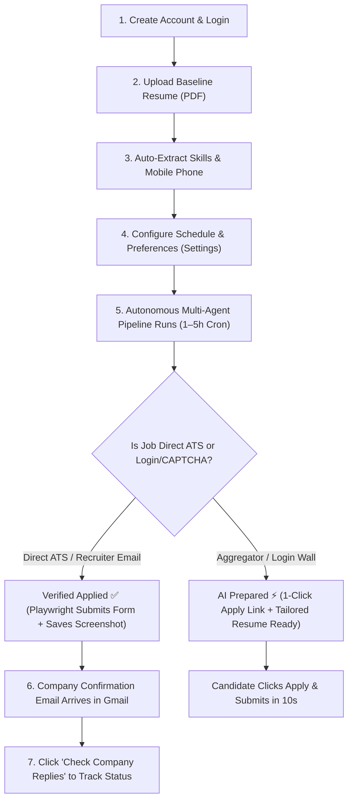

```mermaid
graph LR
    subgraph Discovery ["1. Discovery Agent"]
        D1["Greenhouse Boards"]
        D2["Ashby Boards"]
        D3["Lever Boards"]
        D4["Remote Portals"]
    end

    subgraph Intelligence ["2. AI Intelligence"]
        R1["Gemini Match Scorer"]
        R2["ATS Tailoring Engine"]
        R3["Gemini Cover Letter Drafter"]
    end

    subgraph Execution ["3. Execution & Verification"]
        E1["Playwright Form Submitter"]
        E2["Screenshot Capturer"]
        E3["IMAP Reply Scanner"]
    end

    Discovery --> Intelligence
    Intelligence --> Execution
```

# AutoApply AI — Complete User & Architecture Guide

Welcome to **AutoApply AI**, an open-source, multi-user autonomous job application and verification platform. This guide explains **how to start**, **how it works**, and **how to get the most out of it**.

---

## 1. Quick Overview: What Is AutoApply AI?

AutoApply AI is not just another job scraper or spreadsheet tracker. It is a full-stack multi-agent system designed to:
1. **Discover verified active jobs** across 10+ portals (prioritizing direct company ATS boards like Greenhouse, Lever, and Ashby).
2. **Score matches with Gemini AI** against your real verified resume.
3. **Tailor your resume & cover letter** for each specific role without hallucinating credentials.
4. **Submit automatically** to open public ATS forms and direct recruiter emails via Playwright.
5. **Protect your security** by stopping on login walls and CAPTCHAs, pre-filling a 1-click application package instead.
6. **Track company confirmation emails & replies** (interview invites, confirmations, rejections) in your Gmail/IMAP inbox.
7. **Send hourly verification reports** with live screenshot proof to your **Email and WhatsApp**.

---

## 2. How to Use the App (User Step-by-Step Guide)



### Step 1: Create an Account & Sign In
- Navigate to your live deployment URL (or `http://localhost:5173` if running locally).
- Click **Sign Up** with your real name and email address.
- Each user has a completely isolated profile, database records, and settings.

### Step 2: Upload Your Resume (`/resume`)
- Upload your master resume in **PDF** format.
- The system automatically:
  - Extracts your **Full Name**, **Email**, and **WhatsApp Mobile Phone**.
  - Categorizes your technical skills (*Languages, Frameworks, Cloud, Databases, Tools*).
  - Calculates your baseline **ATS compatibility score**.
  - Generates a clean, single-column **ATS-standard master version**.

### Step 3: Configure Your Automation Preferences (`/settings`)
Go to the **Settings** tab to customize your automated pipeline:
- **Match Sensitivity (Default: 55%):** Adjust the minimum AI match score. Lowering this (e.g., to 45%) applies to more roles; raising it (e.g., to 65%) applies only to strict matches.
- **Actively Hiring Only (Default: ON):** Skips listings older than 14–21 days or postings where the company closed applications.
- **Direct ATS Auto-Apply First (Default: ON):** Prioritizes Greenhouse, Ashby, and Lever boards over aggregators.
- **Cron Frequency Gap:** Choose how often the background agent should run:
  - `Every 1 hr` (`0 * * * *`)
  - `Every 2 hrs` (`0 */2 * * *`)
  - `Every 3 hrs` (`0 */3 * * *`)
  - `Every 4 hrs` (`0 */4 * * *`)
  - `Every 5 hrs` (`0 */5 * * *`)
- **Scheduled Auto-Apply Cron Toggle:** Turn this toggle **ON** to allow automated runs, or **OFF** to pause the background scheduler anytime.
- **WhatsApp Reports:** Enter your WhatsApp phone number (auto-extracted from your resume) and CallMeBot API key for instant hourly push notifications.
- **Company Reply Tracker (IMAP):** (Optional) Add your Gmail App Password to enable hourly background scanning of company confirmations and interview invites.

### Step 4: Review Your Applications & Proof (`/applications`)
Every processed job appears in your **Applications** table with full transparency:
- **Green Badge (`Verified Applied`):** Genuinely submitted directly to the company. Click to open the proof modal, showing the **Playwright confirmation screenshot**, exact confirmation text, and timestamp.
- **Blue Badge (`AI Prepared · 1-Click Apply`):** Tailored resume and Gemini cover letter are prepared. Click **Open Company Site** to paste your details and submit.
- **"Check Company Replies" Button:** Click anytime to scan your inbox for new responses from applied companies.

---

## 3. How the Multi-Agent Pipeline Works Behind the Scenes

AutoApply AI splits the automation process into 6 specialized agent modules:



### 1. Job Discovery Agent
- Scrapes direct public ATS company boards (Stripe, Elastic, Reddit, Okta, GitLab, Brex, Vercel, Linear, Supabase, PostHog, etc.).
- Gathers remote roles from RemoteOK, Himalayas, Remotive, and Jobicy.
- Performs an **actively hiring audit**: discards closed listings, expired links, or non-technical roles.

### 2. AI Ranking & Screening Agent (Gemini)
- Compares the candidate’s verified skills and experience level against the job requirements.
- Calculates an objective 0–100% score based on 5 dimensions:
  1. *Keyword & skill overlap* (35%)
  2. *Years of experience & seniority relevance* (25%)
  3. *Format & structure parseability* (15%)
  4. *Education & degree fit* (15%)
  5. *Quantifiable achievements/metrics* (10%)
- If the score meets your threshold (e.g. 55%), the pipeline proceeds; otherwise, it skips the job to avoid spamming employers.

### 3. Resume Tailoring Engine (`resumeTailoringEngine.ts`)
- Reorders technical skills to foreground the employer's specific required tech stack.
- Aligns the professional summary to highlight relevant years of experience in that role.
- Prioritizes work experience bullet points that showcase related accomplishments.
- **Strict Anti-Hallucination Policy:** Never invents fake skills or degrees.
- Creates a dedicated child version (`resume_versions`) and generates an ATS-compatible single-column PDF via Playwright.

### 4. Cover Letter Agent
- Gemini crafts a personalized, professional 3-paragraph cover letter explaining why your background matches the position.

### 5. Verification Submitter (`externalSubmitter.ts`)
- Inspects the live page using headless Playwright Chromium.
- If a public ATS form is detected:
  - Fills name, email, phone, LinkedIn, GitHub.
  - Uploads the tailored PDF resume.
  - Inserts the cover letter.
  - Submits the form and verifies the real confirmation banner (*"Application submitted"*).
  - Captures a proof screenshot and logs the confirmation.
- If a **login wall** or **CAPTCHA** is detected:
  - Strictly halts to protect your account from bot blocks.
  - Captures a screenshot of the page and sets status to `MANUAL_APPLY_REQUIRED` with a 1-click apply package ready.

### 6. Company Reply Tracker (`companyReplyTracker.ts`)
- Connects securely via read-only TLS IMAP (`EXAMINE INBOX`).
- Searches for incoming emails from applied company domains.
- Categorizes messages into `APPLICATION_CONFIRMED`, `INTERVIEW_INVITE`, or `REJECTED`.
- Updates application status and triggers real-time WhatsApp and Email alerts.

---

## 4. How to Host & Run AutoApply AI

### Running Locally

```bash
# 1. Clone the repository
git clone https://github.com/Mekarthiakhi/autoJobApply.git
cd autoJobApply

# 2. Configure Backend Environment
cd backend
cp .env.example .env
# Edit .env with your keys:
# GEMINI_API_KEY=your_gemini_key
# JWT_SECRET=32_character_random_string

# 3. Install & Start Backend
npm install
npx playwright install chromium
npm run dev

# 4. Install & Start Frontend (in another terminal)
cd ../frontend
npm install
npm run dev
```
Open `http://localhost:5173` in your browser.

---

### Running with Docker

```bash
# Build unified container
docker build -t autoapply-ai .

# Run with persistent volume for database and resumes
docker run -d -p 5000:5000 \
  -e NODE_ENV=production \
  -e JWT_SECRET="your-32-char-random-jwt-secret-key" \
  -e GEMINI_API_KEY="your-gemini-api-key" \
  -e ENABLE_SCHEDULED_JOBS=true \
  -e DISCOVERY_CRON_SCHEDULE="0 * * * *" \
  -v autoapply_data:/app/data \
  --name autoapply autoapply-ai
```

---

### Deploying to Railway (1-Click Cloud Hosting)

1. Fork or push the repo to your GitHub account (`https://github.com/<your-username>/autoJobApply`).
2. Log into [Railway.com](https://railway.com) and click **New Project** → **Deploy from GitHub repo**.
3. Select your repository.
4. Add a **Volume Mount** to the service:
   - Mount Path: `/app/data` (persists SQLite database, uploaded resumes, and proof screenshots).
5. In **Variables**, configure:
   ```env
   NODE_ENV=production
   PORT=5000
   JWT_SECRET=your-secure-random-secret-key-min-32-chars
   GEMINI_API_KEY=your-gemini-api-key
   ENABLE_SCHEDULED_JOBS=true
   DISCOVERY_CRON_SCHEDULE=0 * * * *
   ```
6. Click **Deploy**. Railway will build the React frontend, compile the backend, launch Chromium, and start the service with a public HTTPS domain.

---

## 5. Frequently Asked Questions (FAQ)

### Q: Why didn't the bot submit to all 50 jobs automatically?
**A:** Two reasons:
1. **Match Score Filter:** If a role scores below your threshold (default 55%), the AI skips it to prevent low-relevance spam applications.
2. **Security & Login Walls:** Portals requiring account logins (LinkedIn, Workday) or protected by Cloudflare Turnstile/CAPTCHAs are paused for your safety. The bot packages your tailored resume and provides a 1-click button instead of risking an account ban.

### Q: Does ATS optimization change my original resume?
**A:** No. Your baseline resume remains completely intact. The tailoring engine generates separate child versions tailored to each role, which you can view, edit, or download as PDFs under the **Resume** tab.

### Q: How do I stop or pause the automatic applications?
**A:** Go to **Settings**, toggle **"Scheduled Auto-Apply Cron"** to **OFF**, and click **Save Settings**. To stop it across the entire server, set `ENABLE_SCHEDULED_JOBS=false` in your environment variables.

### Q: How do I receive WhatsApp reports?
**A:** In **Settings**, ensure **WhatsApp Reports** is enabled. AutoApply AI automatically pulls your mobile number from your uploaded resume. Follow the free 30-second instructions to connect CallMeBot, and you will receive hourly verified application summaries directly on WhatsApp.
