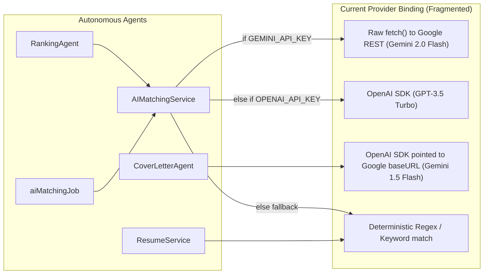
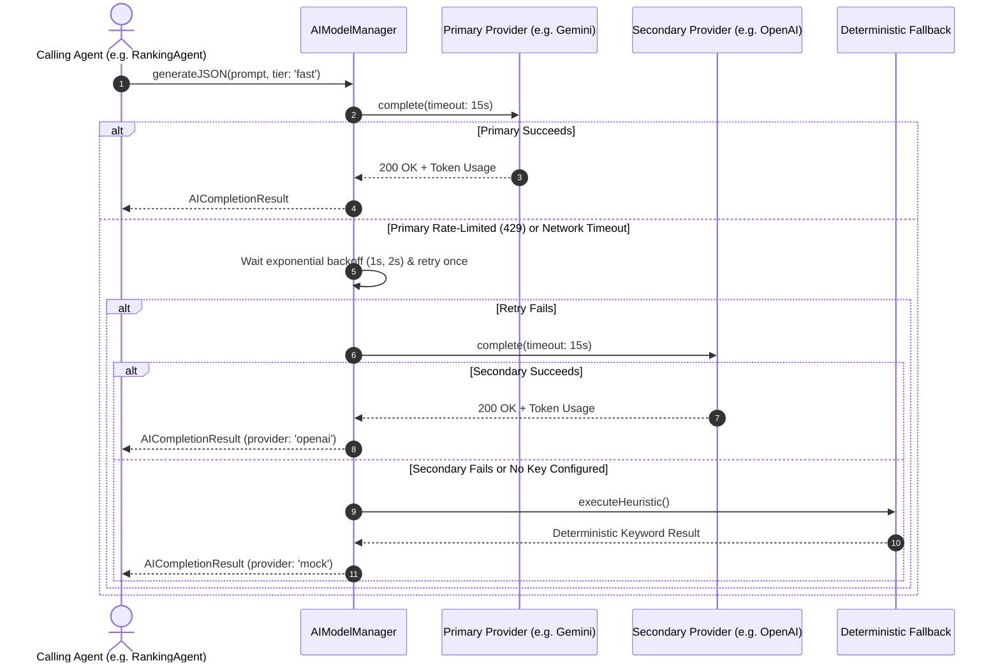

# AutoJobApply — AI Model Provider Architecture Specification

**Document Version:** 1.0  
**Date:** November 2026  
**Status:** Audit Completed & Architecture Specification

---

## 1. Audit of Existing Model Integrations

### 1.1 Model & Provider Inventory

| Provider | Model ID(s) Referenced | Invoking Agents / Services | Integration Pattern |
| :--- | :--- | :--- | :--- |
| **Google Gemini** | `gemini-2.0-flash`<br>`gemini-1.5-flash` | `AIMatchingService`<br>`CoverLetterAgent` | 1. Raw `fetch()` to `https://generativelanguage.googleapis.com/v1beta/models/...`<br>2. OpenAI SDK with `baseURL: 'https://generativelanguage.googleapis.com/v1beta/openai/'` |
| **OpenAI** | `gpt-3.5-turbo` | `AIMatchingService`<br>`CoverLetterAgent` | Official `openai` npm package (`OpenAI` client) |
| **Anthropic (Claude)** | None | None | **Not implemented.** |
| **Deterministic Fallback** | Deterministic heuristics | `AIMatchingService`<br>`ResumeService` | In-memory keyword extraction & score zeroing |

### 1.2 Agent-to-Model Mapping



### 1.3 Existing Configuration & Environment Variables

* **`backend/src/config/env.ts`:**
  * `OPENAI_API_KEY`: Read from `process.env.OPENAI_API_KEY`.
  * `GEMINI_API_KEY`: Read from `process.env.GEMINI_API_KEY`.
  * `ANTHROPIC_API_KEY`: **Missing.**
* **`backend/src/config/openai.ts`:**
  ```ts
  export const openai = new OpenAI({
    apiKey: env.OPENAI_API_KEY,
  });
  ```

---

## 2. Identified Architectural Deficiencies

1. **Dual Incompatible Gemini Clients:**
   * In [`aiMatchingService.ts`](file:///c:/Users/MEDICOVER/Desktop/auto-ai/autoJobApply/backend/src/services/aiMatchingService.ts#L145), Gemini is called via raw `fetch()` directly to Google's REST API (`gemini-2.0-flash`).
   * In [`coverLetterAgent.ts`](file:///c:/Users/MEDICOVER/Desktop/auto-ai/autoJobApply/backend/src/services/coverLetterAgent.ts#L6-L12), Gemini is called by creating an instance of `OpenAI` pointed to Google's OpenAI-compatible proxy (`https://generativelanguage.googleapis.com/v1beta/openai/`) using an API key heuristic check (`startsWith('AIzaSy')`).
2. **Crash on Gemini-Only Deployment:**
   * In `aiMatchingService.optimizeResume()` and `aiMatchingService.negotiateSalary()`, the code calls `openai.chat.completions.create({ model: isGemini ? 'gemini-1.5-flash' : 'gpt-3.5-turbo' })`.
   * Because `openai` comes from `backend/src/config/openai.ts` (configured with `env.OPENAI_API_KEY` and default `api.openai.com`), if a user only provides `GEMINI_API_KEY`, these methods attempt to send `gemini-1.5-flash` to `api.openai.com` with an empty OpenAI key, throwing a fatal `401 Unauthorized`.
3. **Hardcoded Model Identifiers:**
   * Model strings (`gemini-2.0-flash`, `gemini-1.5-flash`, `gpt-3.5-turbo`) are hardcoded across multiple files without central versioning or responsibility tiering.
4. **Zero Token and Cost Tracking:**
   * No API usage statistics (`usage.prompt_tokens`, `usage.completion_tokens`) are recorded or exposed to database metrics.
5. **Missing Timeout and Retry Policies:**
   * No `AbortSignal.timeout(...)` protects HTTP calls from hanging indefinitely if a model provider degrades.
   * No exponential backoff retry exists for transient HTTP 429 (rate limit) or 503 (overloaded) errors.
6. **No Support for Anthropic Claude:**
   * No Claude provider exists to leverage Claude 3.5 Sonnet or Haiku.

---

## 3. Proposed Provider Abstraction Architecture

To eliminate provider lock-in, eliminate hardcoded model names, and ensure reliable execution across all environments, we introduce the **Unified AI Provider Layer** under [`backend/src/ai/`](file:///c:/Users/MEDICOVER/Desktop/auto-ai/autoJobApply/backend/src/ai/).

```mermaid
flowchart TD
    subgraph ConsumerAgents["Agents & Services"]
        RankingAgent["RankingAgent"]
        CoverLetterAgent["CoverLetterAgent"]
        AIMatchingService["AIMatchingService"]
    end

    subgraph ModelManager["AI Model Manager (backend/src/ai/aiModelManager.ts)"]
        Router["Model Router & Tier Dispatcher"]
        CircuitBreaker["Timeout & Retry Policy (Exponential Backoff)"]
        CostCalculator["Token & Cost Accounting"]
        FallbackEngine["Fallback Engine (Gemini -> OpenAI -> Claude -> Mock)"]
    end

    subgraph Providers["Provider Adapters (implements AIProvider)"]
        GeminiAdapter["GeminiProvider (REST / Gemini SDK)"]
        OpenAIAdapter["OpenAIProvider (OpenAI SDK)"]
        ClaudeAdapter["ClaudeProvider (Anthropic REST)"]
        MockAdapter["DeterministicMockProvider (Zero-Config Fallback)"]
    end

    ConsumerAgents -->|request(tier, prompt)| Router
    Router --> CircuitBreaker
    CircuitBreaker --> FallbackEngine
    FallbackEngine --> Providers
    Providers --> CostCalculator
```

---

## 4. Core Abstraction Design

### 4.1 Common Interfaces (`backend/src/ai/types.ts`)

```ts
export type ModelTier = 'fast' | 'quality' | 'reasoning';
export type ProviderName = 'gemini' | 'openai' | 'claude' | 'mock';

export interface AICompletionOptions {
  tier?: ModelTier;
  temperature?: number;
  maxTokens?: number;
  timeoutMs?: number;
  maxRetries?: number;
  systemPrompt?: string;
  responseFormat?: 'text' | 'json';
}

export interface TokenUsage {
  promptTokens: number;
  completionTokens: number;
  totalTokens: number;
  estimatedCostUsd: number;
}

export interface AICompletionResult<T = any> {
  content: string;
  parsed?: T;
  provider: ProviderName;
  model: string;
  usage: TokenUsage;
  durationMs: number;
}

export interface AIProvider {
  readonly name: ProviderName;
  isAvailable(): boolean;
  complete(prompt: string, options: AICompletionOptions): Promise<AICompletionResult>;
}
```

### 4.2 Responsibility-Based Model Tiers

Instead of agents requesting specific vendor model strings, agents request a **Model Tier**:

| Tier | Agent Responsibility | Gemini Model | OpenAI Model | Claude Model | Characteristics |
| :--- | :--- | :--- | :--- | :--- | :--- |
| **`fast`** | ATS Scoring, Job Classification, Filter | `gemini-1.5-flash` | `gpt-4o-mini` | `claude-3-5-haiku-20241022` | Ultra-low latency, low cost, strict JSON formatting |
| **`quality`** | Tailored Cover Letters, Resume Rewrite | `gemini-1.5-pro` | `gpt-4o` | `claude-3-5-sonnet-20241022` | High stylistic nuance, professional tone, no placeholders |
| **`reasoning`**| Complex Salary Negotiation, Strategic Gaps | `gemini-2.0-flash` | `o3-mini` / `gpt-4o` | `claude-3-5-sonnet-20241022` | Deep context window, complex multi-constraint reasoning |

---

## 5. Token & Cost Calculation Matrix

Estimated cost in USD per 1M tokens based on standard commercial API pricing:

| Provider | Model | Input / 1M Tokens | Output / 1M Tokens |
| :--- | :--- | :---: | :---: |
| **Gemini** | `gemini-1.5-flash` | $0.075 | $0.30 |
| **Gemini** | `gemini-1.5-pro` | $1.25 | $5.00 |
| **Gemini** | `gemini-2.0-flash` | $0.10 | $0.40 |
| **OpenAI** | `gpt-4o-mini` | $0.15 | $0.60 |
| **OpenAI** | `gpt-4o` | $2.50 | $10.00 |
| **Claude** | `claude-3-5-haiku` | $0.80 | $4.00 |
| **Claude** | `claude-3-5-sonnet`| $3.00 | $15.00 |

---

## 6. Resilience, Retries & Fallback Policy



### Key Guarantees:
1. **Never Crash:** If no API keys are configured, or all APIs are down, the system transparently degrades to deterministic heuristics without throwing unhandled exceptions.
2. **Timeout Enforcement:** Default 20,000 ms timeout per call via `AbortController`.
3. **Transient Retry:** 1 exponential backoff retry for HTTP 429 and 503 errors.

---

## 7. Security & Key Isolation Rules

1. **Server-Side Exclusivity:** API keys (`GEMINI_API_KEY`, `OPENAI_API_KEY`, `ANTHROPIC_API_KEY`) are read strictly within Node.js `process.env`.
2. **Zero Frontend Exposure:** No API keys are exported via Vite (`VITE_*`) or sent down to client bundles.
3. **Log Sanitization:** `logger` calls log only `provider`, `model`, `durationMs`, and `totalTokens`. Raw API keys and sensitive prompt text are never written to disk or console.

