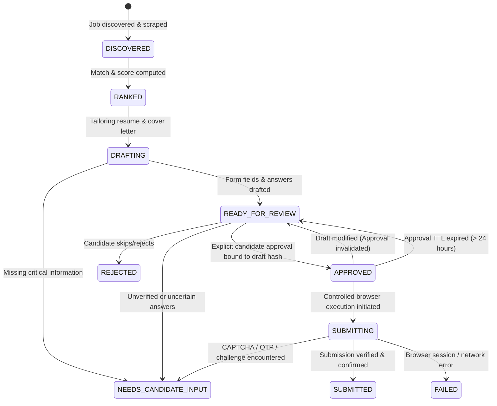

# Phase 10: Application Review and Controlled Execution Architecture

## 1. Executive Summary

Phase 10 implements the **Review Queue and Controlled Execution Subsystem** of AutoJobApply. It enforces strict, non-bypassable human-in-the-loop governance over all job application submissions. While AI agents automate job discovery, ATS scoring, resume tailoring, and form preparation, **every single job application requires explicit, individual candidate approval prior to final submission**.

---

## 2. Mandatory Application State Machine

### 2.1 Formal State Definitions
1. **DISCOVERED**: Newly scraped job posting saved in database.
2. **RANKED**: Scored by Explainable Scorer (skills, experience, salary, location match).
3. **DRAFTING**: AI agents preparing tailored resume version, cover letter, and form answers.
4. **READY_FOR_REVIEW**: Application draft assembled with selected resume, cover letter, and proposed answers. Ready for candidate inspection.
5. **NEEDS_CANDIDATE_INPUT**: Execution paused due to missing required fields, low-confidence answers, CAPTCHA, OTP, or ambiguous questions.
6. **APPROVED**: Candidate has reviewed all answers, confirmed verification, and granted explicit individual approval. Cryptographically bound to the current draft hash with an expiration TTL.
7. **SUBMITTING**: Controlled browser session actively loading the form with verified approval token.
8. **SUBMITTED**: Final confirmation screenshot captured; application recorded as officially submitted.
9. **FAILED**: Non-recoverable session error or timeout.
10. **REJECTED**: Candidate declined to apply.

---

## 3. Cryptographic Draft Hash Binding & Invalidation

To guarantee that a candidate never submits something different from what was reviewed, approval is bound to an immutable content hash:

$$\text{DraftHash} = \text{SHA-256}\Big(\text{jobId} + \text{resumeVersionId} + \text{coverLetterId} + \text{canonicalJSON}(\text{answers})\Big)$$

### 3.1 Strict Invalidation Rules
1. **Draft Invalidation**: If the candidate or an agent modifies any answer, switches the resume version, or edits the cover letter after approval, the system immediately recalculates $\text{DraftHash}$. Because $\text{CurrentHash} \neq \text{ApprovedHash}$, approval is **instantly invalidated**, transitioning status back to `READY_FOR_REVIEW`.
2. **Expiration TTL (24 Hours)**: Approvals carry a mandatory 24-hour time-to-live (`approval_expires_at`). If an approved application is not submitted within 24 hours, the approval expires to prevent stale submissions against expired postings.
3. **Duplicate Submission Prohibition**: If an application status is `SUBMITTED`, all subsequent submission attempts are rejected as duplicate.

---

## 4. Controlled Browser Automation & Anti-Bot Sentinel

The browser agent operates under strict safety constraints:
1. **Preparation Only**: Prepares form fields (name, email, phone, work history, answers) but **strictly halts** at the final submission button.
2. **Never Checks Legal / Consent Checkboxes**: Form checkboxes regarding terms of service, background check consents, arbitration agreements, and legal declarations are **never selected automatically**. They remain unchecked for manual candidate verification.
3. **Never Bypasses Anti-Bot Gates**: If Cloudflare Turnstile, Google reCAPTCHA, hCaptcha, LinkedIn security verification, or SMS OTP is detected, the browser pauses immediately, transitions to `NEEDS_CANDIDATE_INPUT`, and alerts the candidate.
4. **Backend Authorization Gate**: Before clicking Submit, the automation engine calls `verifyApprovalBeforeSubmission(userId, applicationId)`. Unless the backend returns `isAuthorized: true`, the submission action is completely blocked.

---

## 5. Security & Policy Enforcement

- **Individual Approval Mandate**: Every application must be reviewed and approved independently.
- **Bulk Approval Disabled**: The `approveAll` endpoint is disabled by default policy, returning HTTP 403 Forbidden.
- **Backend Ownership Enforcement**: Every approval, answer modification, and submission request validates that `request.userId === application.user_id`.
- **Immutable Audit Trail**: All lifecycle transitions are logged to `activity_logs` with timestamps, actor IDs, draft hashes, and error messages.

