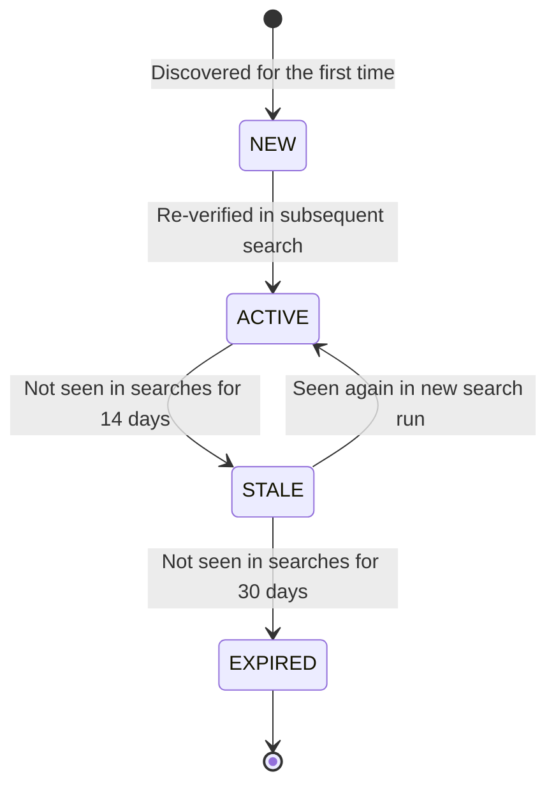

# AutoJobApply — Job Discovery & Intelligence Architecture Specification

**Document Version:** 1.0  
**Date:** November 2026  
**Status:** Completed Architecture Specification

---

## 1. Platform Integration & Access Restriction Audit

| Platform | Integration Method | Access Constraints & Anti-Bot Mechanisms | Safe Operating Policy |
| :--- | :--- | :--- | :--- |
| **LinkedIn** | Chrome CDP (`http://localhost:9222`) attached to live session | 1. Aggressive bot detection on headless browsers.<br>2. Rate limit: ~20-50 queries/day before temporary search restriction.<br>3. Security verification / PIN challenge. | Use existing authenticated Chrome context via CDP.<br>**Never attempt to automate PIN, 2FA, or CAPTCHA solving.** When challenged, halt with `CHALLENGED` status. |
| **Indeed** | Chrome CDP / Headless Chromium with stealth args | 1. Cloudflare Turnstile bot challenges.<br>2. IP-based velocity rate limits on `/jobs` queries.<br>3. Cookie walls & email capture modals. | Non-destructive cookie acceptance via `popupAgent`.<br>Minimum 2,000ms delay between page requests.<br>**Do not bypass Turnstile/Cloudflare.** |
| **Glassdoor** | Headless Chromium | 1. Mandatory registration overlay after 2-3 searches.<br>2. Cloudflare protection. | Dismiss dismissable promotion modals.<br>If hard login-wall detected, extract visible card data only and pause. |
| **Naukri** | Headless Chromium | 1. Fast rate limiting on search endpoints.<br>2. OTP challenges on login / sensitive operations. | Read-only public search pagination.<br>Minimum 1,500ms delay between pages.<br>**Never bypass OTP challenges.** |
| **Career Pages** | Direct Playwright DOM navigation (Workday, Greenhouse, Lever, Ashby) | 1. Diverse iframe and shadow DOM structures.<br>2. Sporadic Cloudflare protection. | Standard semantic selectors, fallback text extraction, and non-destructive screenshot verification. |

---

## 2. Normalized Job Schema

To eliminate disparate data representations across scrapers, all ingested jobs are normalized into `NormalizedJob`:

```ts
export interface NormalizedSalary {
  raw?: string;
  min?: number;
  max?: number;
  currency?: string;
  period?: 'yearly' | 'monthly' | 'hourly';
}

export type ExperienceLevel = 'entry' | 'mid' | 'senior' | 'lead' | 'executive' | 'unspecified';
export type EmploymentType = 'Full-Time' | 'Part-Time' | 'Contract' | 'Internship' | 'Temporary' | 'Other';
export type JobStatus = 'new' | 'active' | 'stale' | 'expired';

export interface NormalizedJob {
  id?: string;
  title: string;
  companyName: string;
  location: string;
  isRemote: boolean;
  salary: NormalizedSalary;
  experienceLevel: ExperienceLevel;
  employmentType: EmploymentType;
  requiredSkills: string[];
  jobDescription: string;
  applyUrl: string;
  canonicalUrl: string;
  source: 'linkedin' | 'indeed' | 'glassdoor' | 'naukri' | 'career_page' | 'other';
  externalId: string;
  postedDate: string;
  discoveredAt: string;
  lastSeenAt: string;
  status: JobStatus;
}
```

---

## 3. Two-Tier Deduplication Strategy

```mermaid
flowchart TD
    RawJob["Raw Scraped Job"] --> Norm["Normalizer (Canonical URL + String Clean)"]
    Norm --> L1{"Level 1: Exact Match?"}
    L1 -->|Yes: (source, external_id) or canonicalUrl exists| UpdateSeen["Update last_seen_at = CURRENT_TIMESTAMP (No Duplicate Row)"]
    L1 -->|No| L2{"Level 2: Fuzzy Similarity Match?"}
    L2 -->|Normalized Company & Title similarity >= 85% & same location| CrossDup["Link as Cross-Platform Duplicate (Update Primary last_seen_at)"]
    L2 -->|No| InsertNew["Insert New Job (status = 'new', last_seen_at = CURRENT_TIMESTAMP)"]
```

### Similarity Algorithm:
1. Normalize company name: lower-case, remove legal suffixes (`Inc`, `LLC`, `Ltd`, `Corp`, `Technologies`, `Software`).
2. Normalize job title: lower-case, remove fluff (`Urgent Hiring`, `Immediate Joiner`, `[Remote]`).
3. Jaccard token similarity:
   $$\text{Similarity}(T_1, T_2) = \frac{|T_1 \cap T_2|}{|T_1 \cup T_2|}$$
4. If similarity $\ge 0.85$ and normalized locations match, jobs are identified as identical opportunities cross-posted to multiple platforms.

---

## 4. Stale & Expired Job Lifecycle Management



* **Stale Threshold:** 14 days without being seen in new search runs.
* **Expired Threshold:** 30 days without being seen in new search runs.
* Expired jobs are filtered from search feeds by default to keep candidate pipelines fresh and relevant.

---

## 5. Explainable Multi-Dimensional Job Scoring Engine

Instead of an opaque black-box number, every job match score is deterministic, weighted, and fully explainable with component factors:

| Factor | Weight | Evaluation Criteria |
| :--- | :---: | :--- |
| **Skills Match** | **35%** | Jaccard overlap of required job skills with candidate resume skills. Matches award proportional credit; missing skills are highlighted. |
| **Experience Match** | **15%** | Matches candidate years of experience / seniority against job level (`entry`, `mid`, `senior`, `lead`). |
| **Location & Remote Preference** | **15%** | Full credit for Remote jobs when candidate prefers remote, or geographic string match on city/state. |
| **Salary Expectation** | **15%** | Full credit if job salary $\ge$ candidate minimum; partial credit if within 10%; neutral credit (50%) if salary unlisted. |
| **Job Title Relevance** | **10%** | Token overlap between candidate target roles and job title. |
| **Employment Type Match** | **5%** | Candidate desired type (e.g. Full-Time) vs job type. |
| **Freshness** | **5%** | $\le 2$ days: 100%; $\le 7$ days: 80%; $\le 14$ days: 50%; $> 21$ days: 20%. |

### Output Contract:
```ts
export interface ScoreExplanationFactor {
  name: string;
  score: number;
  maxScore: number;
  reason: string;
}

export interface ExplainableScoreResult {
  totalScore: number; // 0 - 100
  recommendation: 'Apply' | 'Maybe' | 'Skip';
  factors: ScoreExplanationFactor[];
  summary: string;
}
```

---

## 6. Safety & Non-Bypass Guarantees

1. **Zero Bot Bypass:** The system strictly obeys platform anti-bot mechanisms. Cloudflare, Turnstile, Google reCAPTCHA, and OTP challenges immediately suspend scraping with `CHALLENGED` status.
2. **Read-Only Discovery:** Job discovery strictly reads postings and extracts metadata. No buttons for "Apply", "Easy Apply", or form submission are ever triggered during discovery.
3. **Server-Side Key Isolation:** All credentials (if configured) remain in server environment variables.

