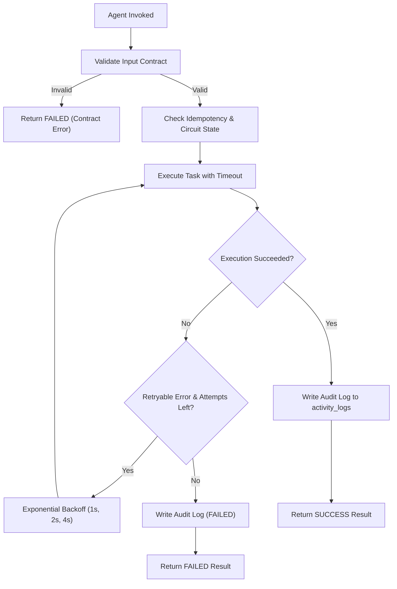

# AutoJobApply — Multi-Agent System Architecture Specification

**Document Version:** 1.0  
**Date:** November 2026  
**Status:** Completed Architecture Specification

---

## 1. System Overview & Philosophy

The AutoJobApply Multi-Agent System orchestrates specialized, autonomous micro-agents to streamline job discovery, resume matching, application draft preparation, and applicant tracking.

### Core Tenet: Strict Human-in-the-Loop Boundary
* AI agents are granted autonomy to **search, normalize, evaluate, research, score, draft, and inspect**.
* AI agents are **strictly prohibited** from:
  1. Submitting any application autonomously.
  2. Guessing or inventing candidate credentials, skills, or answers.
  3. Automatically consenting to legal agreements or declarations.
  4. Bypassing the Review Queue.
* Every job application draft must halt at `AWAITING_HUMAN_APPROVAL` until an authorized candidate explicitly approves submission.

---

## 2. Agent Responsibility Matrix (12 Core Responsibilities)

All 12 responsibilities map directly to existing modules in the codebase:

| # | Responsibility | Existing Component | Provider / Engine | Primary Tooling | DB Read/Write |
| :--- | :--- | :--- | :--- | :--- | :--- |
| **1** | **Job Discovery** | `JobDiscoveryService`<br>`unifiedJobScraper` | Playwright / HTTP Scrapers | Scraper engines (LinkedIn, Indeed, Naukri, Glassdoor, Career Pages) | Read: `settings`<br>Write: `jobs` |
| **2** | **Job Normalization & Deduplication** | `PlannerAgent`<br>`JobRepository` | Deterministic Algorithm | UUID v4, URL canonicalization, SQL indexing | Read: `applications`, `jobs`<br>Write: none |
| **3** | **Job Ranking & Matching** | `RankingAgent`<br>`AIMatchingService` | `aiModelManager` (Tier: `fast`) | Gemini 1.5 Flash / GPT-4o-mini / Heuristic | Read: `resume_versions`, `jobs`<br>Write: `match_scores` |
| **4** | **Company Research** | `BrowserAgent`<br>`AIMatchingService` | Playwright CDP / `aiModelManager` | Headless Chrome, metadata scrapers | Read: `jobs`<br>Write: `jobs` (enhanced metadata) |
| **5** | **Resume Analysis** | `ResumeService` | Deterministic Keyword & Section Parser | PDF-parse, regex section boundary parser | Read: `resumes`, `resume_versions`<br>Write: `resume_versions` |
| **6** | **Resume Optimization** | `AIMatchingService.optimizeResume()` | `aiModelManager` (Tier: `quality`) | Gemini 1.5 Pro / GPT-4o | Read: `resume_versions`, `jobs`<br>Write: none |
| **7** | **Cover Letter Drafting** | `CoverLetterAgent` | `aiModelManager` (Tier: `quality`) | Gemini 1.5 Pro / GPT-4o | Read: `resume_versions`, `jobs`<br>Write: `cover_letters` |
| **8** | **Application Preparation** | `WorkflowOrchestrator`<br>`ApplicationService` | Deterministic Orchestrator | Draft package builder | Read: `jobs`, `resumes`, `cover_letters`<br>Write: `applications` (`review_status='pending'`) |
| **9** | **Application Review** | `ReviewAgent` | Deterministic Authorization Guard | Human Review Queue, ownership validator | Read: `applications`, `users`<br>Write: `applications`, `activity_logs` |
| **10**| **Browser Automation** | `BrowserAgent`<br>`popupAgent` | Playwright Chromium (CDP) | Non-destructive page navigation, screenshot capture, question extractor | Read: `jobs`<br>Write: screenshot PNG files |
| **11**| **Notification** | `TelegramService`<br>`EmailService` | Telegraf / Resend API | Multi-channel dispatchers | Read: `users`, `notifications`<br>Write: `notifications` |
| **12**| **Analytics & Audit** | `LoggerAgent`<br>`analyticsController` | SQLite SQL Aggregations | CSV / TSV exporters, event logging | Read: `activity_logs`, `applications`<br>Write: `activity_logs` |

---

## 3. Detailed Agent Specifications & Contracts

### 3.1 Job Discovery Agent
* **Input Schema:**
  ```ts
  interface JobDiscoveryInput {
    targetRoles: string[];
    targetLocations: string[];
    platforms: ('linkedin' | 'indeed' | 'naukri' | 'glassdoor' | 'career_pages')[];
    limitPerPlatform?: number;
  }
  ```
* **Output Schema:**
  ```ts
  interface JobDiscoveryOutput {
    discoveredCount: number;
    newJobsSaved: number;
    jobIds: string[];
    errors: Array<{ platform: string; error: string }>;
  }
  ```

### 3.2 Job Normalization and Deduplication Agent
* **Input Schema:**
  ```ts
  interface DeduplicationInput {
    userId: string;
    jobIds: string[];
  }
  ```
* **Output Schema:**
  ```ts
  interface DeduplicationOutput {
    totalChecked: number;
    duplicateCount: number;
    uniqueJobIds: string[];
  }
  ```

### 3.3 Job Ranking and Matching Agent
* **Input Schema:**
  ```ts
  interface JobRankingInput {
    userId: string;
    resumeText: string;
    job: {
      id: string;
      title: string;
      description: string;
      requiredSkills?: string[];
      location?: string;
      salary?: string;
    };
    threshold?: number;
  }
  ```
* **Output Schema:**
  ```ts
  interface JobRankingOutput {
    jobId: string;
    score: number; // 0-100
    recommendation: 'Apply' | 'Maybe' | 'Skip';
    matchingSkills: string[];
    missingSkills: string[];
    strengths: string[];
    breakdown: {
      skillMatch: number;
      titleMatch: number;
      locationMatch: number;
      salaryMatch: number;
    };
    meetsThreshold: boolean;
  }
  ```

### 3.4 Company Research & Browser Inspection Agent
* **Input Schema:**
  ```ts
  interface BrowserInspectionInput {
    jobId: string;
    applyUrl: string;
    timeoutMs?: number;
  }
  ```
* **Output Schema:**
  ```ts
  interface BrowserInspectionOutput {
    jobId: string;
    pageTitle: string;
    screenshotPath: string | null;
    scrapedQuestions: string[];
    hasLoginWall: boolean;
    warnings: string[];
  }
  ```

### 3.5 Cover Letter Agent
* **Input Schema:**
  ```ts
  interface CoverLetterInput {
    userId: string;
    jobId: string;
    jobTitle: string;
    companyName: string;
    jobDescription: string;
    resumeText: string;
    resumeVersionId?: string | null;
  }
  ```
* **Output Schema:**
  ```ts
  interface CoverLetterOutput {
    coverLetterId?: string;
    content: string;
    wordCount: number;
    isTailored: boolean;
  }
  ```

### 3.6 Application Preparation Agent
* **Input Schema:**
  ```ts
  interface ApplicationPreparationInput {
    userId: string;
    jobId: string;
    resumeVersionId: string | null;
    coverLetterId?: string | null;
    matchScore: number;
    screenshotPath?: string | null;
    warnings: string[];
    scrapedQuestions: string[];
  }
  ```
* **Output Schema:**
  ```ts
  interface ApplicationPreparationOutput {
    applicationId: string;
    status: 'pending';
    reviewStatus: 'pending';
    queuedAt: string;
  }
  ```

### 3.7 Application Review Agent
* **Input Schema:**
  ```ts
  interface ApplicationReviewInput {
    userId: string;
    applicationId: string;
    action: 'approve' | 'reject';
    notes?: string;
    explicitUserConfirmation: boolean;
  }
  ```
* **Output Schema:**
  ```ts
  interface ApplicationReviewOutput {
    applicationId: string;
    status: 'approved' | 'rejected';
    reviewStatus: 'approved' | 'rejected';
    decidedAt: string;
    auditLogId: string;
  }
  ```

---

## 4. Multi-Agent Workflow State Transitions

```mermaid
stateDiagram-v2
    [*] --> IDLE
    IDLE --> PLANNING: User triggers workflow / scheduled cron
    PLANNING --> DISCOVERING: Search criteria configured
    DISCOVERING --> DEDUPLICATING: Raw job postings scraped
    DEDUPLICATING --> RANKING: New unique jobs identified
    
    state RANKING {
        [*] --> EVALUATE_FIT
        EVALUATE_FIT --> SCORE_COMPUTED
    }
    
    RANKING --> INSPECTING: Job meets threshold (>= 50%)
    RANKING --> SKIPPED: Job below threshold
    SKIPPED --> [*]

    state INSPECTING {
        [*] --> BROWSER_NAVIGATE
        BROWSER_NAVIGATE --> DISMISS_COOKIES
        DISMISS_COOKIES --> CAPTURE_SCREENSHOT
        CAPTURE_SCREENSHOT --> EXTRACT_QUESTIONS
    }

    INSPECTING --> DRAFTING: Page inspected & verified
    
    state DRAFTING {
        [*] --> COMPOSE_COVER_LETTER
        COMPOSE_COVER_LETTER --> ASSEMBLE_DRAFT_PACKAGE
    }

    DRAFTING --> AWAITING_HUMAN_APPROVAL: Draft saved in Review Queue
    
    state AWAITING_HUMAN_APPROVAL {
        note right of AWAITING_HUMAN_APPROVAL
            MANDATORY SAFETY BOUNDARY:
            Workflow halts here.
            Autonomous application submission is completely blocked.
        end note
    }

    AWAITING_HUMAN_APPROVAL --> APPROVED: Explicit User Click "Approve & Apply"
    AWAITING_HUMAN_APPROVAL --> REJECTED: User Click "Reject"

    APPROVED --> SUBMITTING: Scraper dispatches with human confirmation
    SUBMITTING --> APPLIED: Platform confirms receipt
    SUBMITTING --> SUBMISSION_FAILED: Form error / CAPTCHA detected

    APPLIED --> NOTIFYING: NotificationAgent alerts candidate
    SUBMISSION_FAILED --> NOTIFYING: NotificationAgent alerts error

    NOTIFYING --> [*]
    REJECTED --> [*]
```

---

## 5. Agent Execution Lifecycle & Observability

Every agent in the system conforms to the standardized execution lifecycle:



### Execution Status Types:
* `PENDING`: Scheduled for execution.
* `RUNNING`: Actively executing.
* `SUCCESS`: Completed with valid output adhering to contract.
* `FAILED`: Errored out; failure isolated and recorded in audit logs.
* `AWAITING_HUMAN_APPROVAL`: Execution paused pending candidate decision.
* `CANCELLED`: Aborted by user or circuit breaker.

---

## 6. Resilience, Idempotency & Error Recovery

1. **Deterministic Idempotency:**
   * Unique constraint on `jobs(source, external_id)` prevents scraping duplicate postings.
   * Unique constraint on `applications(user_id, job_id)` prevents queuing duplicate applications for the same role.
2. **Error Isolation:**
   * A failure during browser inspection or cover letter drafting for job $N$ does not abort processing of job $N+1$.
   * Transient network errors undergo exponential backoff (up to 2 retries).
3. **Audit Trails:**
   * Every major state change writes an event to `activity_logs` with `user_id`, `job_id`, `action`, `status`, and JSON `details`.

