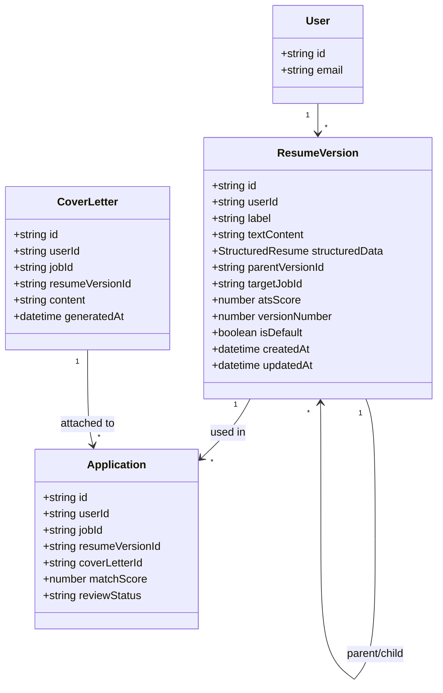

# Phase 9: Resume and Application Intelligence Architecture

## 1. Executive Overview

The **Resume and Application Intelligence Subsystem** elevates AutoJobApply from a raw document uploader to an intelligent, candidate-centric career assistant. It provides:
1. **Multi-Version Resume Management**: Candidates can maintain multiple base resumes (e.g. Frontend, Backend, Engineering Management) and generate job-tailored variants.
2. **High-Fidelity Structured Extraction**: Extracts contact basics, categorized technical skills, work experience items with impact metrics, education, projects, and certifications from plain text and PDF files.
3. **Transparent ATS Compatibility Scoring**: Evaluates candidate resumes against job descriptions across 5 explainable dimensions (0–100 scale).
4. **Strict Non-Hallucinatory Suggestions**: Recommends enhancements using the STAR method (Situation, Task, Action, Result) grounded exclusively in the candidate's verified achievements. Never fabricates credentials, years of experience, or unpossessed skills.
5. **Non-Destructive Job Tailoring**: Creates tailored resume drafts branched as distinct versions linked to the target job, preserving original documents unaltered.
6. **Application Lineage Tracking**: Records the exact resume version and cover letter ID linked to every job application.
7. **ATS-Compliant PDF Export & Validation**: Uses headless Chromium to generate clean, single-column, ATS-scannable PDF documents and verifies document formatting compliance.

---

## 2. Core Principles & Safety Guardrails

> [!IMPORTANT]
> **Human Sovereignty & Non-Destructive Storage**:
> - **Original Preservation**: The user's original uploaded resume is immutable unless explicitly deleted or overwritten by the user. Generated job-specific drafts are stored as child versions (`parent_version_id`, `target_job_id`).
> - **Full Candidate Reviewability**: Every generated resume draft and cover letter is fully reviewable and editable before submission or export.
> - **No Hallucination Policy**: AI prompting and deterministic heuristic rules strictly prohibit inventing employers, projects, degrees, or technical capabilities. Missing skills are flagged as learning opportunities or qualification gaps, never injected into the candidate's profile.

---

## 3. Data Models & Typed Contracts



### 3.1 `StructuredResume` Schema
```typescript
export interface CandidateBasics {
  fullName: string;
  email: string;
  phone?: string;
  location?: string;
  linkedinUrl?: string;
  githubUrl?: string;
  portfolioUrl?: string;
  summary?: string;
}

export interface CategorizedSkills {
  languages: string[];
  frameworks: string[];
  cloudDevOps: string[];
  databases: string[];
  tools: string[];
  softSkills: string[];
  all: string[];
}

export interface WorkExperienceItem {
  id: string;
  company: string;
  role: string;
  location?: string;
  startDate: string;
  endDate: string;
  isCurrent: boolean;
  highlights: string[];
}

export interface EducationItem {
  id: string;
  institution: string;
  degree: string;
  fieldOfStudy?: string;
  graduationYear?: string;
  gpa?: string;
}

export interface ProjectItem {
  id: string;
  name: string;
  description: string;
  technologies: string[];
  link?: string;
}

export interface CertificationItem {
  id: string;
  name: string;
  issuer: string;
  issueDate?: string;
}

export interface StructuredResume {
  basics: CandidateBasics;
  skills: CategorizedSkills;
  experience: WorkExperienceItem[];
  education: EducationItem[];
  projects: ProjectItem[];
  certifications: CertificationItem[];
}
```

---

## 4. ATS Compatibility & Scoring Architecture

The ATS Compatibility engine computes an explainable 0–100 score across 5 weighted dimensions:

$$\text{ATS Score} = S_{\text{Keywords}} (35\%) + S_{\text{Experience}} (25\%) + S_{\text{Formatting}} (15\%) + S_{\text{Education}} (15\%) + S_{\text{Impact}} (10\%)$$

1. **Keyword & Skill Match (35%)**:
   - Token intersection of required vs candidate skills.
   - Identifies matching keywords and missing keywords.
2. **Experience & Role Relevance (25%)**:
   - Compares candidate's cumulative verified experience against job requirement (e.g. 5+ years).
   - Computes seniority gap if experience < required.
3. **Formatting & Parseability (15%)**:
   - Contact info presence (email, phone, name).
   - Standard section headers (`EXPERIENCE`, `EDUCATION`, `SKILLS`).
   - Bullet structure consistency and character length checks.
4. **Education & Certification Relevance (15%)**:
   - Degree level match (Bachelor's, Master's, equivalent domain experience).
5. **Quantifiable Impact Score (10%)**:
   - Analyzes experience bullet points for metrics, percentages, revenue, latency improvements, or volume indicators (e.g. `40% latency reduction`, `$2M revenue`).

---

## 5. Non-Hallucinatory Suggestions Framework

Suggestions adhere to a strict non-hallucination constraint:
- **Action Verbs**: Transform passive phrases (*"was responsible for frontend"*) into active STAR achievements (*"Architected and deployed responsive React dashboard"*).
- **Metric Prompts**: Prompts the candidate to insert genuine metrics where available (*"Consider adding the latency percentage or throughput metric achieved during the database optimization"*).
- **Skill Prominence**: Reorders existing verified skills to highlight the tools prioritized by the target job.
- **Honest Gap Disclosure**: Missing required qualifications are identified as gaps rather than fabricated.

---

## 6. Job-Specific Resume Tailoring Pipeline

1. **Fetch Baseline**: Retrieves candidate's selected resume version (`StructuredResume`).
2. **Analyze Target Job**: Parses required skills, job title, company name, and key responsibilities.
3. **Re-rank & Highlight**:
   - Tailors professional summary to align genuine candidate achievements with job mission.
   - Reorders skills categories to foreground target stack technologies.
   - Reorders and formats experience bullets to emphasize high-relevance projects.
4. **Child Version Branching**:
   - Creates a new record in `resume_versions` with:
     - `parent_version_id`: Points to baseline resume version.
     - `target_job_id`: Points to the target job.
     - `label`: `"Tailored for [Company] - [Role]"`.
     - `version_number`: Incremented.
     - `is_default`: `0` (never displaces default baseline).
5. **Human Review**: The candidate reviews the generated draft, makes manual edits, exports to PDF, or queues it for application.

---

## 7. ATS-Compliant PDF Export & Document Validator

### 7.1 Validation Checks
- **Required Sections Check**: Ensures Contact, Experience, Education, and Skills exist.
- **Length & Density Check**: Alerts if resume text is under 150 words or exceeds 2 pages (~1,200 words).
- **Special Characters**: Detects non-standard unicode characters that can break legacy ATS parsers.

### 7.2 Headless Chromium PDF Generation
- Uses Playwright headless Chromium (`page.pdf({ format: 'A4', printBackground: true, margin: { top: '0.5in', bottom: '0.5in', left: '0.5in', right: '0.5in' } })`).
- Single-column, ATS-optimized typography (Helvetica/Arial/system-ui), high contrast, standard line height (1.4–1.5), selectable text.
- Fallback to clean HTML export if browser execution is unavailable.

---

## 8. Application Lineage Tracking

Every record in `applications` references:
- `resume_version_id`: Foreign key to `resume_versions(id)`.
- `cover_letter_id`: Foreign key to `cover_letters(id)`.

Candidates can query:
- `GET /api/resume-versions/:id/applications`: Lists all jobs where that specific resume version was deployed.
- `GET /api/applications`: Returns full application histories with linked resume version labels and match scores.

