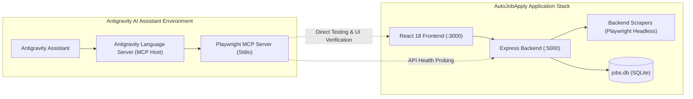

# AutoJobApply — Antigravity MCP Integration Specification

**Document Version:** 1.0  
**Date:** November 2026  
**Status:** Playwright MCP Configured & Evaluated  
**Configuration File:** `~/.gemini/config/mcp_config.json`  
**Backup:** [`backups/mcp_config.json.bak`](file:///c:/Users/MEDICOVER/Desktop/auto-ai/autoJobApply/backups/mcp_config.json.bak)

---

## 1. Key Distinction: Agent Tooling vs Application Backend

> [!IMPORTANT]
> **MCP Tooling Boundary:**
> Model Context Protocol (MCP) servers configured in Antigravity (`~/.gemini/config/mcp_config.json`) provide tools directly to the **AI Assistant Agent** during development sessions (e.g., enabling the assistant to drive browser tests, query repository PRs, or view Notion docs).
>
> They **do NOT** alter the AutoJobApply Node.js/Express backend, nor do they grant the web application runtime access to Notion or GitHub. The application backend continues to communicate independently with its configured services (Playwright scrapers, OpenAI/Gemini, SQLite, Resend, Telegram) via its own internal services and environment variables.



---

## 2. Comprehensive Candidate Evaluation

### 1. Playwright MCP (`@executeautomation/playwright-mcp-server`)
* **Purpose:** Browser automation, visual UI verification, end-to-end regression testing, element inspection, screenshot evidence collection.
* **Compatibility:** Fully compatible with Antigravity via Node.js Stdio transport.
* **Credentials Required:** **None.** Runs 100% locally on the developer machine using local Chromium.
* **Permissions / Least-Privilege:** Standard local process execution (`npx.cmd`). Local network access to `localhost:3000` and `localhost:5000`.
* **Current Status:** **CONFIGURED & ACTIVE** in `~/.gemini/config/mcp_config.json`.
* **Capabilities Provided to Agent:**
  * `playwright_navigate`: Open URLs (e.g. `http://localhost:3000/review-queue`).
  * `playwright_click`: Test user click flows on buttons and modals.
  * `playwright_fill`: Input test data into forms.
  * `playwright_screenshot`: Capture visual regression evidence.
  * `playwright_evaluate`: Inspect DOM structure and CSS properties.

---

### 2. GitHub MCP (`@modelcontextprotocol/server-github`)
* **Purpose:** Repository inspection, checking pull requests, listing issues, reviewing git commit history, repository branch comparison.
* **Compatibility:** Officially supported reference MCP server; Stdio transport.
* **Credentials Required:** `GITHUB_PERSONAL_ACCESS_TOKEN` (Fine-grained Personal Access Token recommended).
* **Least-Privilege Scopes:**
  * **Repository Access:** Selected repositories only (`AutoJobApply`).
  * **Permissions:**
    * `Contents`: Read-only.
    * `Pull Requests`: Read-only (or Read & Write if PR creation assistance is desired).
    * `Issues`: Read-only.
    * `Metadata`: Read-only.
  * **Prohibited:** No Administration, Secrets, Webhooks, or Organization permissions.
* **Activation Guide:**
  When a token is generated, add to `~/.gemini/config/mcp_config.json`:
  ```json
  {
    "mcpServers": {
      "playwright": {
        "command": "npx.cmd",
        "args": ["-y", "@executeautomation/playwright-mcp-server"]
      },
      "github": {
        "command": "npx.cmd",
        "args": ["-y", "@modelcontextprotocol/server-github"],
        "env": {
          "GITHUB_PERSONAL_ACCESS_TOKEN": "YOUR_FINE_GRAINED_TOKEN_HERE"
        }
      }
    }
  }
  ```

---

### 3. Notion MCP (`antigravity-plugins-partners/plugin/notion`)
* **Purpose:** Sync technical decision logs, engineering specs, development roadmaps, and bug trackers directly with team Notion workspaces.
* **Compatibility:** Available in Antigravity Marketplace as an official partner plugin, or via `@modelcontextprotocol/server-notion`.
* **Credentials Required:** Notion Internal Integration Token (`NOTION_API_KEY`).
* **Least-Privilege Scopes:**
  * Read content, Update content.
  * No user email access.
  * Explicit page invitation: Integration must be explicitly invited to designated pages (e.g., "AutoJobApply Docs") via the Notion page "Share" &rarr; "Add connection" menu.
* **Activation Guide:**
  Available either via marketplace card:
  `<plugin-card catalog-id="antigravity-plugins-partners/plugin/notion"></plugin-card>`
  Or via `mcp_config.json`:
  ```json
  "notion": {
    "command": "npx.cmd",
    "args": ["-y", "@modelcontextprotocol/server-notion"],
    "env": {
      "NOTION_API_KEY": "YOUR_NOTION_INTEGRATION_TOKEN_HERE"
    }
  }
  ```

---

### 4. Filesystem MCP (`@modelcontextprotocol/server-filesystem`)
* **Purpose:** Controlled directory read/write access.
* **Evaluation & Decision:** **NOT RECOMMENDED / EXCLUDED.**
  * Antigravity already provides native, high-performance, built-in filesystem tools (`read_file`, `write_file`, `edit_file`, `run_command`).
  * Installing `@modelcontextprotocol/server-filesystem` would introduce redundant tools into the agent's context window, increasing token overhead and latency without adding any new capability.

---

## 3. Active Configuration

**File:** `C:\Users\MEDICOVER\.gemini\config\mcp_config.json`
```json
{
  "mcpServers": {
    "playwright": {
      "command": "npx.cmd",
      "args": ["-y", "@executeautomation/playwright-mcp-server"]
    }
  }
}
```

## 4. Verification Check
* JSON syntax verified via PowerShell `ConvertFrom-Json`.
* Stdio transport compatible with local Windows Node.js runtime.
* Prior empty configuration backed up to `backups/mcp_config.json.bak`.
* Zero application backend source code modified.

